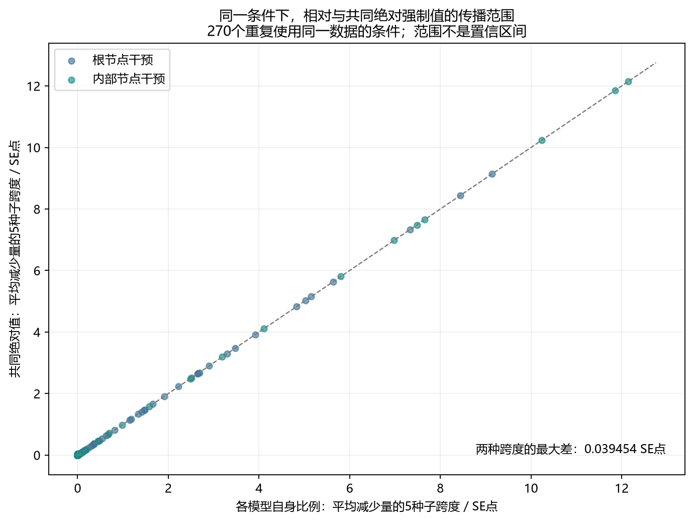
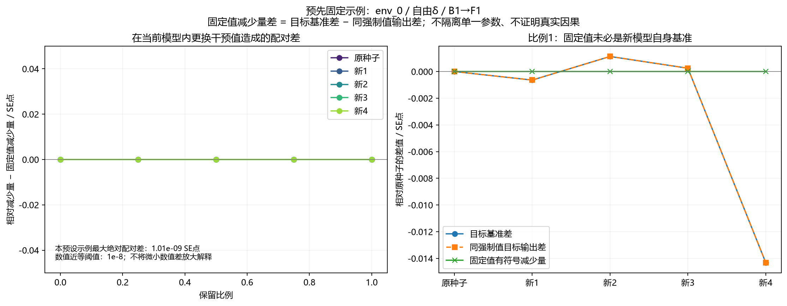

# 共同绝对值传播对照：结果与汇报说明

## 为什么继续做这一轮

上一轮18号已经检查五个求解种子模型的相对退化传播，但每个模型使用“自身预测基准×保留比例”，非零比例时实际强制值可能不同。本轮把同一环境、模型类别、基础样本、干预节点和比例的强制值统一到原种子20261122的预测基准，检查改变干预值定义是否改变原有敏感性描述。

原种子是约定的参照，不是真实值；不同环境、模型类别和基础样本仍有不同的参考值。本轮没有把全部模型、全部样本都强制到一个统一常数，也没有重新拟合、生成SE、改边或挑选种子。上一轮提交2bf8ce7与远程已联网核对一致，18号结果独立标量复核再次通过。

## 面板、变量与两种配对比较

保留5个种子、3环境×2模型、9组可达关系、5档比例和原30个留出基础样本，新增40500条共同绝对值响应，与18号原40500条相对响应逐条配对。只读取原外部根观测，不读取中间节点观测真值做递推。

设b_s为种子s的干预节点基准，B_s为该模型的目标节点基准，Y_s(v)为强制干预节点到v后的目标输出，原种子记作0，比例为q。

- 相对减少量R_s＝B_s−Y_s(q×b_s)。
- 共同值减少量A_s＝B_s−Y_s(q×b_0)。
- 固定模型、更换干预值的配对差：R_s−A_s＝Y_s(q×b_0)−Y_s(q×b_s)。
- 固定共同干预值、跨模型比较：A_s−A_0＝(B_s−B_0)−[Y_s(q×b_0)−Y_0(q×b_0)]。

第二个分解明确区分目标基准差与同一强制值下的目标输出差。它是代数核对和模型比较，不是单参数因果识别。不能拿两个跨度直接相减当作贡献，也不能把同一数据上的重复条件当成独立实验。

## 图1：统一绝对值后，原有传播跨度是否还存在

每个点是一个环境×模型×干预节点×目标×比例条件。横轴是18号相对方案的五种子均值跨度，纵轴是共同绝对值方案的五种子均值跨度；每个种子先在同一30基准上平均。虚线表示两种跨度相等。点可能重叠，270条件不等于270个独立实验。

270个条件中，13个条件的两种跨度差超过1e-8，最大差约0.039454 SE点，出现在env_0.3/自由δ/B1→F1、比例1。该条件相对方案是各模型自身基准的恒等操作，所以相对减少量都为0；共同值方案范围约−0.000000331至0.039454。

本批最大的共同值传播跨度仍出现在env_0/自由δ/B2置零→F2：42.572315—54.721779，跨度12.149463 SE点，与18号相同。因为比例0时所有模型的强制值本来都是0，统一参考基准不会消除这类模型差异。根节点干预也保持原外部根观测，故原种子、零值和根干预分别构成8100、8100、27000条控制比较；这些计数互有重叠，不能相加成独立实验数。

在本面板内，平均减少量的参考值配对差绝对值最大约0.039454 SE点。这不意味着逐条差异也只这么大，不是应用容许误差结论，也不能外推为任意模型下参考值不重要。

## 图2：保留预先固定的近零结果，不事后换例子

示例在运行前沿用09/18的env_0/自由δ/B1→F1。左图的最大平均参考值配对差约1.01e-9 SE点，小于1e-8数值近等阈值；显示尺度明确保留这一近零结果，没有放大解释，也没有在看完结果后换成差异最大的条件。

右图为比例1下相对原种子的目标基准差、同强制值输出差及共同值有符号减少量。该预设示例中前两项几乎抵消，共同值减少量数值近零；这个现象不表示所有比例1条件都为零。完整摘要里的env_0.3/B1→F1等条件仍有可见的非零变化。

## 为什么有负的“减少量”

共同强制值来自原种子，可能高于某新模型自己的干预节点基准；这时模型输出可能增加，B_s−Y_s可以为负。全部40500条均可用，其中104条共同值高于自身干预基准（阈值1e-8），103条目标减少量小于−1e-8，均发生在比例1。负减少量范围约−0.736432至−1.01e-8 SE点，已保留，没有裁剪、删样本或错误套用“比例1必为零”。高于基准未必使目标增加，所以两个计数不必相等。

目标输出越界0条，目标直接供给超训练范围19080条（47.11%）。这只是目标直接供给覆盖标记，不代表整条路径都受训练数据约束。参考输入相同仍可能位于训练范围外，不能因此称作真实故障验证。

## 核验与复现依据

独立标量实现重算40500条共同值响应及配对40500条相对响应，核验256500次数值非后代比较、原种子/零值/根干预控制、270行条件摘要及1350行种子均值；最大绝对差约2.13e-14。配对分解在生产计算中的最大残差约1.42e-14。核验不调用生产传播实现或拟合器。

240项不同相关测试通过，新增7项覆盖：强制值跨种子相同及控制复现、比例1负减少量保留、配对分解、失败任务不可用、内部真值不进入递推及来源不变、非法基准/比例/重复面板、非空输出保护。

- [预登记方案](预登记方案.json)、[完整报告](absolute_report.json)。
- [两种定义的传播范围](相对与绝对传播范围.csv)、[逐种子配对分解](逐种子配对分解.csv)。
- [完整数组与掩码](共同绝对值响应数组.npz)：轴标签见报告axes，包含有符号减少量、目标输出、共同强制值、基准、valid、outside、extrapolated、reference_exceeds_own、negative_decrease。
- [独立核验](独立标量核验.json)、[回归测试记录](回归测试记录.json)、[执行环境与代码版本](执行环境与代码版本.json)。

[复跑命令和解释约定](../absolute-seed-propagation.md)。本发布快照manifest.json核对其他文件精确字节，包含已有独立核验记录；独立重算需指向本地完整结果目录和来源。原06/17/18来源包保留不变。

## 汇报表述与当前边界

“为排查各模型自身基准不同造成的干预值差异，进一步补充共同绝对强制值对照，并分开记录目标基准差和同强制值输出差。在本次固定种子面板内，统一参考值后仍保留主要置零传播差异；相对比例与共同绝对值回答不同问题，比例1不能对所有模型都当成无干预。”

这是对第5项传播稳定性解释的进一步限定，不是预测精度提升、单参数真实因果识别、参数唯一性或有效置信区间。没有覆盖其他求解器、更多起点、训练重采样×种子交叉设计或真实数据校准。第5项整体仍部分完成，九项分类仍为5项已落实当前范围、2项部分完成、2项待新增优化。

发布CSV仅规范行尾为LF，保留BOM及全部数值，本地原字节不变。原七包统一目录保持原登记，本新增结果使用独立核验入口。
