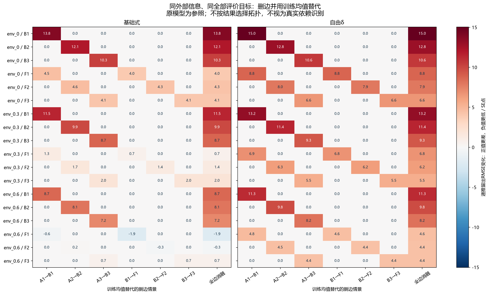
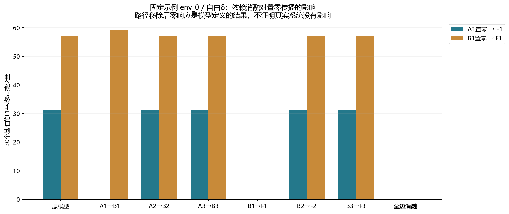

# 同信息、同目标的训练均值依赖消融

对原六条边逐一消融，并增加全边消融，共7个对照与1个原模型。失去唯一入边的节点显式使用原90个训练基础样本目标均值；新根不读取观测真值，全部六个原接受节点继续评价，只有原A1/A2/A3作为外部观测输入。原30个留出基础样本、模型设置、SE与正式映射不变。这是无依赖的统计零假设对照，不是撤销产品消费事实。

正值表示递推留出RMSE更高，负值表示更低。局部和递推、训练和留出分别在完整CSV中报告，保持同目标同记录面板。未受影响任务分量必须完全一致；原模型8640个预测重算最大差2.84e-14。训练均值是已估计的1个常数参数，不能称零参数；名义参数维度不等于可辨识自由度。

六个单边消融的受影响递推留出比较中，每种模型有27组：自由δ模型27组误差更高；基础式24组更高、3组更低（沿用1e-8近等口径）。这里统计的是重复使用同一留出集的条件比较，不是27个独立实验，不作显著性或真实依赖识别结论；也不改变此前与OLS对照的结论。

只给原根观测的限制专指整网递推。局部评价仍按原方案提供该目标的直接供给观测，非切断节点用原局部方程，切断节点仍只用训练常数；不能把局部误差解释为仅外部根输入下的整网误差。

各情景先用原根输入计算自身基准，再按同五档保留比例重算，保留原9组可达关系用于对照。子图已断开的关系明确标记不可达并核对零响应，不从表中删除。比例0的绝对强制值都是0，非零比例下可能不同，不作固定绝对干预比较。新常数根仍可被显式干预，干预时暂停常数方程；被断开上游的置零不能再传到它。

本步属于剩余方程冻结、训练均值替代的受限数值拓扑消融。直接改边节点的原α/β/δ方程被整体移除，以训练均值替代；未变方程只在输入供给关系、观测训练数据和设置均未变时保留原参数，并非把原接受方程强套到零输入。新增18个训练均值，各有90条训练记录，未调用FDNA求解器。不是完整T-Refit，也不把两种实验混报。

实际保存69120个局部/递推预测值与64800条下游响应，保留原所有评价目标、不可达标记、目标预测越界和目标直接供给外推提示。常数目标没有供给时，覆盖标记为不适用，不能当成已验证输入覆盖。

现有留出此前已查看，本轮不选择最佳拓扑，不据误差变化宣布真实依赖成立或不成立。05的待审结构提案仍保持待审，只在隔离实验报告中进行数值计算，不批准正式映射。真实数据、不同结构及完整重估拓扑比较仍待后续验证。
