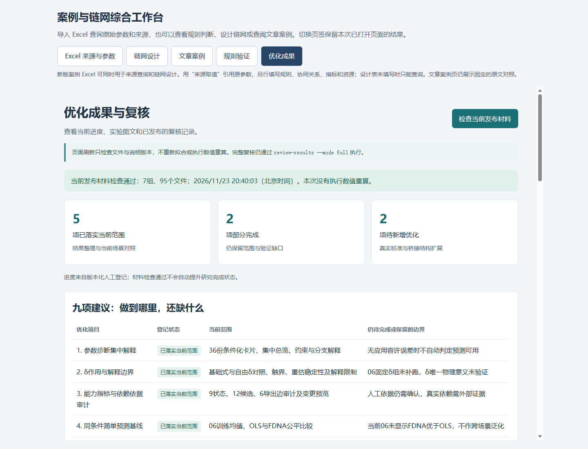
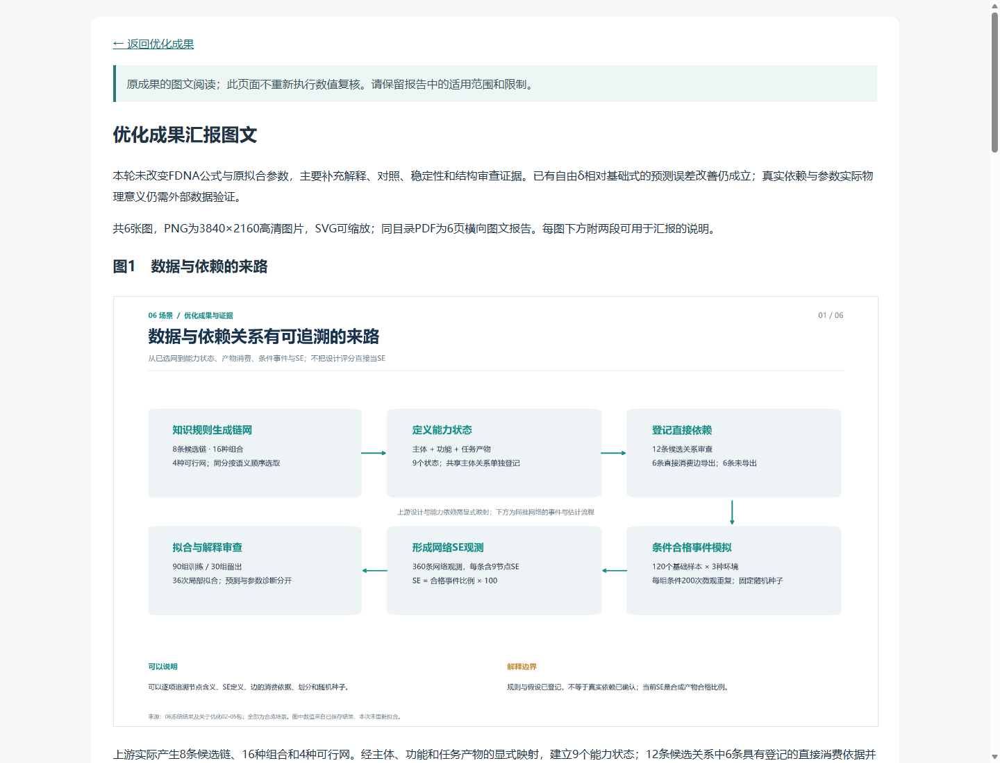
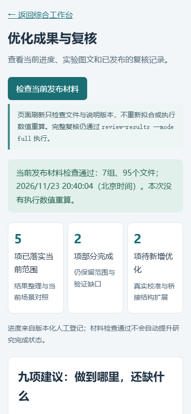

# 优化成果网页与检查快照

[使用说明](../evidence-web.md) · [浏览器自动检查](browser_check.json) · [本次发布材料检查](材料检查.json)

综合工作台新增“优化成果”页签，可查看九项进度、七组图文及最近发布的完整复核记录。当前材料检查与历史数值复核分开；网页刷新不重新拟合、不运行完整数值核验。

199项相关测试通过，全部18张原PNG通过HTTP读取。Edge无界面自动检查通过页签选中、材料刷新、新标签页阅读与390像素页面无整体横向溢出。原UI助手未能初始化，故本记录明确为自动浏览器检查，不声称手动UI验收。原图文、模型、参数和数据没有改动。

截图仅记录当次界面，不等于本机已重新执行历史数值复核。manifest.json用于核对此快照的精确字节。
