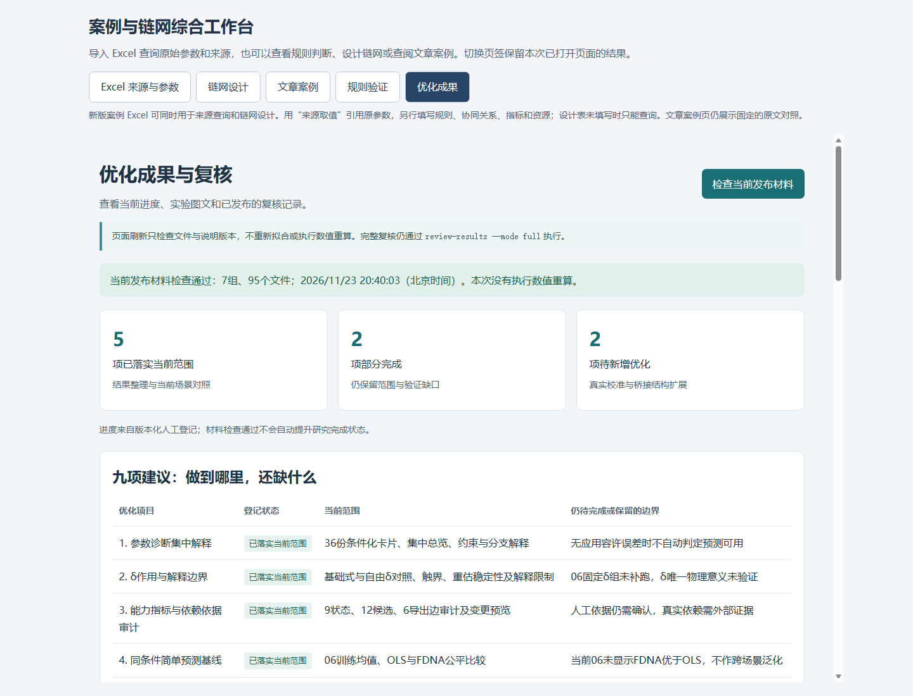
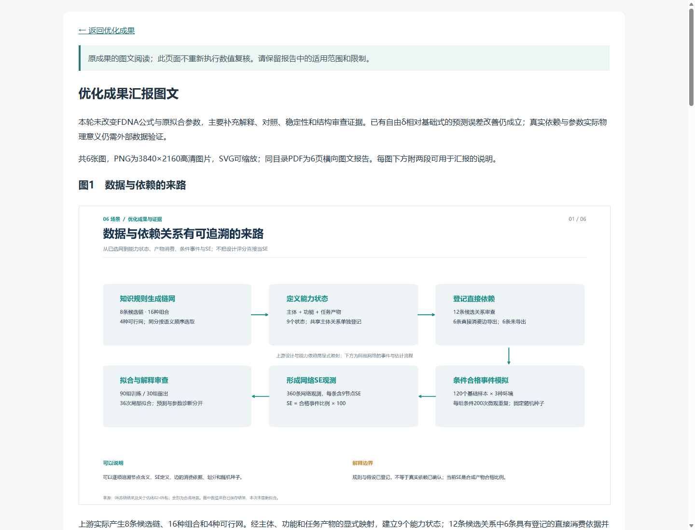

# 在综合工作台查看优化成果

综合工作台新增“优化成果”页签，也可直接打开`http://127.0.0.1:8765/fdna-results`。使用原网页启动方式即可，无需新增Python或浏览器依赖。

页面集中显示九项建议的已登记进度、当前范围与未完成事项，提供七组原实验图文、两份方法/使用说明，以及最近发布的完整复核记录。18张原PNG图表均可读取，图文在新标签页打开，保留原工作台已打开页面的结果。

## 当前检查与历史复核分开

“检查当前发布材料”重新检查95个发布文件与两份说明的版本，不写generated、不拟合、不生成SE、不执行完整数值核验。文件变化或缺失时显示失败、隐藏该包预览并阻止正常图文阅读，不把旧图继续标成当前检查通过。

“最近发布的完整复核”读取已发布记录，显示它自己的时间、任务状态及与当前材料是否一致。本页当前检查时间与历史复核时间分开，均显示北京时间。历史记录的字节检查不通过时显示不可用；目录、材料或说明变化时不会声称历史记录与当前一致。

需要实际重新执行完整数值复核，仍使用[统一复核命令](evidence-review.md)。网页查询不接受任意本地路径，不通过页面触发完整重拟合或脚本执行。当前5项已落实范围、2项部分完成、2项待新增优化的研究分类保持不变。

## 图文与文件范围

网页只提供目录登记成果包中、清单已列出且摘要一致的PNG/SVG/PDF/CSV/JSON/Markdown，以及两份版本匹配的说明。Markdown以受限阅读器显示标题、段落、表格、图片和代码，源HTML转义；不执行报告内的HTML或脚本，不提供原始HTML页面。未支持链接会明确标注，不扩展到其他本地文件。

## 验证与截图

199项相关测试通过，覆盖原Excel上传与校验、新页签、材料刷新接口、图文与全部18张PNG、篡改、路径范围、历史/当前版本区分、HTML转义及手机布局相关数据。只读网页入口不加载NumPy/SciPy拟合库，保留原Excel入口的基础依赖；完整数值复核仍使用项目原FDNA依赖。

本次在本机Edge无界面模式实测：进入工作台`#evidence`后页签选中，刷新产生新的材料请求，图文链接打开新标签页，第一份报告的6张图在页面中登记、首图实际载入；390像素宽度下整体页面无横向溢出。桌面与手机截图已查看。原浏览器/Windows UI助手初始化失败，因此本次明确记录为自动浏览器检查，不声称手动UI验收。





手机布局和原始自动检查记录见[网页检查快照](evidence-web-report/README.md)。

复跑时先启动本地服务（示例端口8897），再用Node 24及已安装Edge运行；输出与浏览器配置须使用不同的新空目录，不使用个人浏览器配置：

```powershell
& '..\..\.venv\Scripts\python.exe' -B -m excel_entry.app --port 8897
# 在另一个终端执行。路径可根据本机Edge安装位置调整。
node workflow_tools/check_evidence_browser.mjs --browser 'C:\Program Files (x86)\Microsoft\Edge\Application\msedge.exe' --profile '..\..\tmp\evidence-web-new-profile' --output-dir '..\..\generated\关于优化\14_优化成果网页\新的浏览器检查' --url 'http://127.0.0.1:8897'
```

自动检查使用独立无界面浏览器和本地CDP通道，结束时关闭该实例，不更改个人浏览器设置。部分受限环境需在允许浏览器启动的权限下运行；检查记录不代表任意浏览器或设备均已验收。
