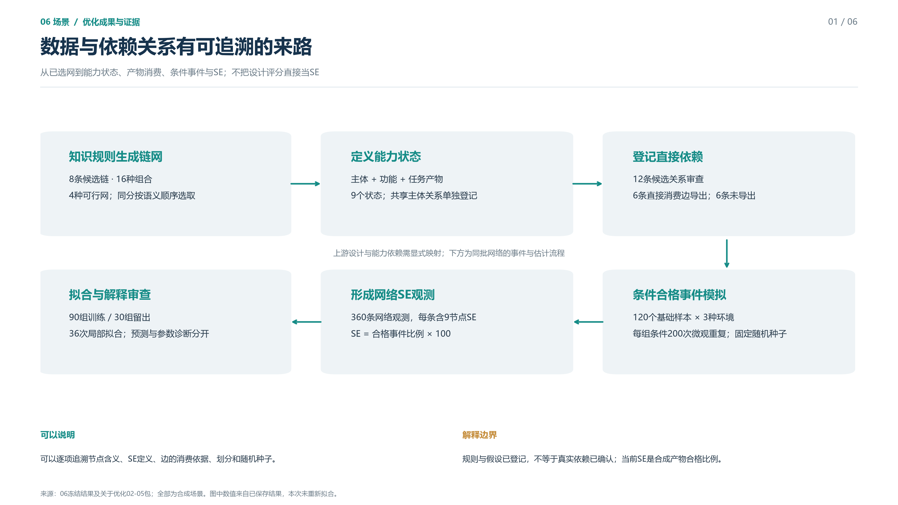
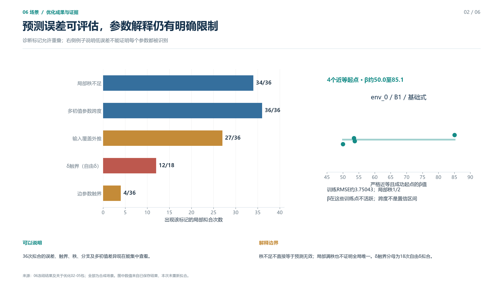
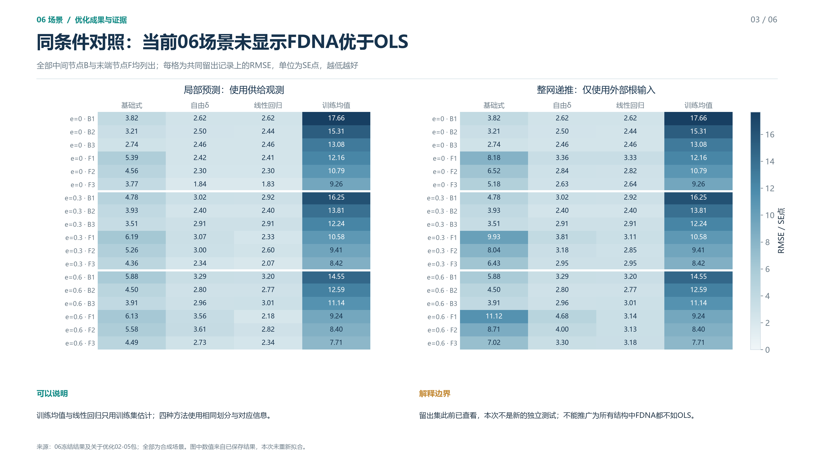
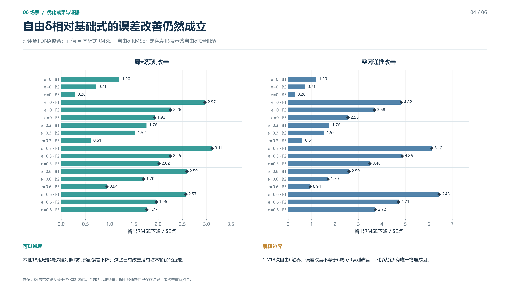
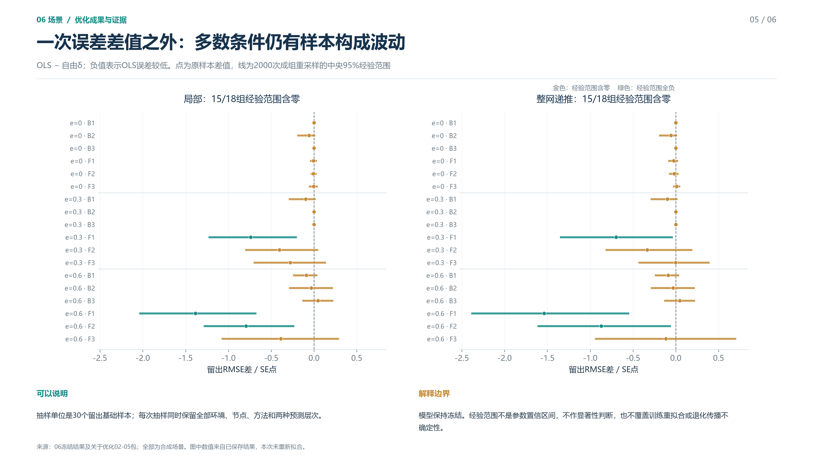
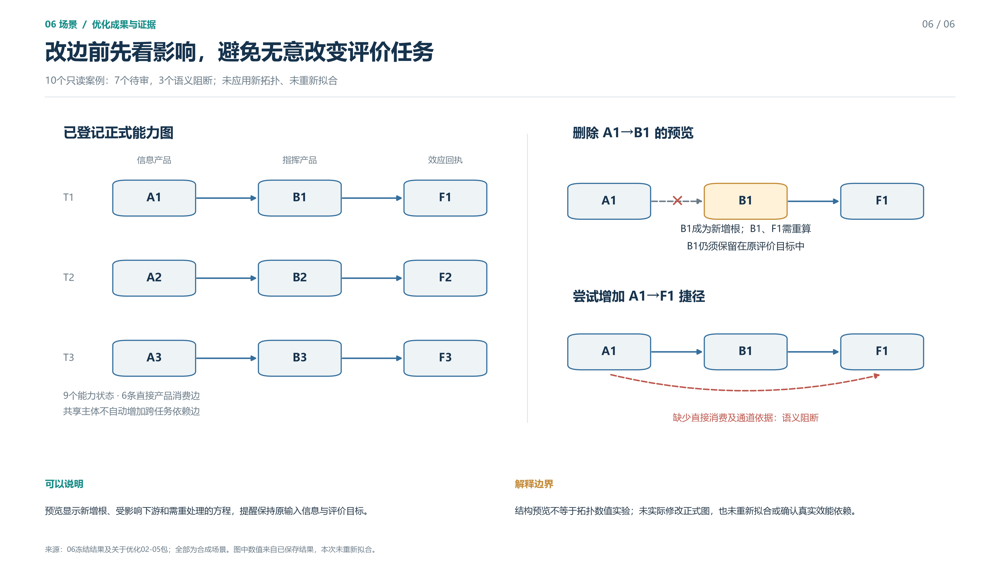

# 优化成果汇报图文

本轮未改变FDNA公式与原拟合参数，主要补充解释、对照、稳定性和结构审查证据。已有自由δ相对基础式的预测误差改善仍成立；真实依赖与参数实际物理意义仍需外部数据验证。

共6张图，PNG为3840×2160高清图片，SVG可缩放；同目录PDF为6页横向图文报告。每图下方附两段可用于汇报的说明。

## 图1　数据与依赖的来路

上游实际产生8条候选链、16种组合和4种可行网。经主体、功能和任务产物的显式映射，建立9个能力状态；12条候选关系中6条具有登记的直接消费依据并被导出。共享主体、通道可用和间接可达关系没有自动转换成依赖边。

SE来自已登记的条件合格事件模拟：120个基础样本对应3种配对环境，共360条网络观测，每条含9个节点SE；每组条件有200次微观重复。按基础样本划分90组训练、30组留出，避免同一基础样本的环境版本跨集合。当前验证了可追溯的合成流程，不代表真实装备效能已校准。

## 图2　参数诊断让解释更有边界

36次局部拟合中，34次局部秩不足，36次存在多初值参数跨度，27次有输入覆盖外推标记；18次自由δ拟合中12次触界。这些标记可以重叠，不能相加作为拟合总数。诊断优化使这些证据集中可见，而不是只展示一组看似确定的参数。

具体到env_0/B1基础式，4个严格近等且成功的起点训练误差几乎相同，但β从约50.00变化到85.06。该节点局部秩为1/2，β在当前训练分支不活跃。因此低误差不能证明α、β都被唯一识别；该跨度不是参数置信区间。

## 图3　公平基线明确了当前方法定位

图中覆盖3种环境、6个接受节点以及局部和整网递推两种预测层次，每个条件均使用30条共同留出记录。局部比较使用相同供给观测；递推比较只获得相同外部根输入，中间节点由各自模型预测，避免给某种方法额外的目标信息。

对自由δ而言，OLS的局部RMSE在18组中13组更低、4组数值近等、1组更高；递推对应12、4、2组。近等仅指绝对差不超过1e-8，不是显著性或应用容许误差。已有留出集此前已查看，本次不构成新的独立测试。当前06场景不支持FDNA预测优于OLS的主张；但基线没有α/β依赖语义，也不能据此推论所有数据与结构的通用方法排名。

## 图4　保留改善证据，同时保留解释限制

基础式和自由δ使用相同数据与划分。18组配对结果的局部和整网递推留出RMSE均下降，说明已运行的自由δ扩展在本批数据中改善了预测。末端递推的改善还包含上游预测变化向下游传递的作用，不能与单个局部方程的改善混为一谈。

黑色菱形标记12次自由δ触界。原文引入δ用于修正归一化可能带来的误差；本项目中δ是否还吸收遗漏因素或结构失配，仍是诊断假设。误差下降不能证明δ具有唯一物理意义。本轮没有改公式、参数或边界，也没有增加固定δ实验。

## 图5　稳定性分析限制了过强的方法排名

从30个留出基础样本中有放回抽取30个，重复2000次。同一次抽样联合保留全部环境、节点、方法与局部/递推记录，不把配对环境版本或200次微观事件当成独立网络样本。原模型不重新拟合。

OLS−自由δ的18组RMSE差，局部和递推均有15组的中央经验范围包含零。其余3组范围均为负，分别是env_0.3/F1、env_0.6/F1和env_0.6/F2。结果提示“多数点估计较低”不能直接提升为所有条件都稳定获胜。这些范围只描述当前冻结预测的样本构成波动，不是参数置信区间或显著性检验。

## 图6　结构审查提前暴露比较条件的变化

本次预览覆盖6个单边删除、3条无直接产品消费的捷径以及1个全边删除，共10个案例，7个保留待审、3个语义阻断。正式能力图、候选审查状态和拟合参数均没有改变，源包操作前后94个文件校验一致。

删除A1→B1会使B1成为根，B1与F1需要重算。若直接把B1观测真值当作新根输入，并从原接受节点误差表中去掉B1，就改变了信息集和评价任务。预览明确保留这些待处理事项；无消费与直接通道依据的A1→F1捷径也不会因为间接可达而被自动批准。这是结构审查功能，不是替代拓扑数值实验。

## 汇报结论

老师追问时，可分别回答数据来源、参数约束和方法比较三个问题：生成规则与计数记录可追溯；拟合完成不等于参数唯一；当前06场景不支持FDNA预测优于简单线性方法的主张。依赖表达和模型内传播的研究价值仍应单独论证。

本轮图表只读取已保存结果，没有重新拟合、生成SE、修改δ边界或应用新拓扑。诊断标记可重叠；经验范围不作参数置信或显著性结论。
