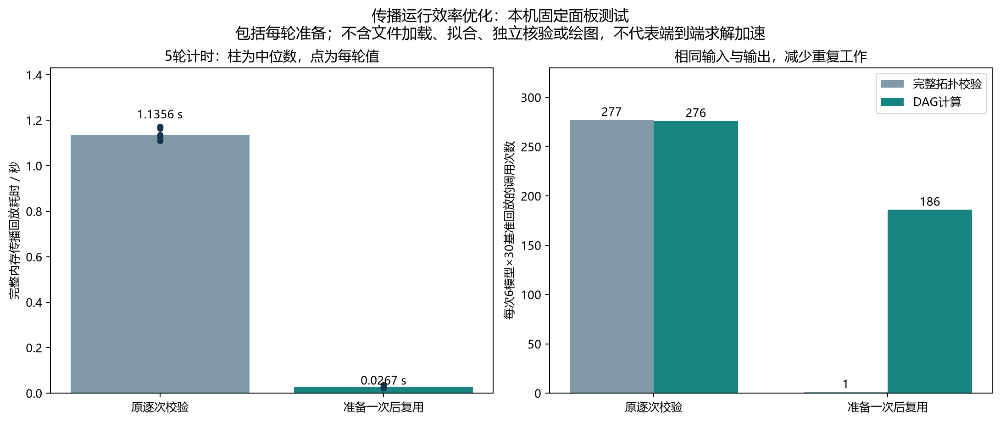

# 传播计算效率优化

同一原30个留出基准、6个模型任务、9组关系、五档比例，保留参数、数据、公式、缺失掩码与未裁剪输出。每个显式准备对象复制并冻结拓扑和参数，不保留观测；每次调用仍检查根输入和干预维度。相同模型×根输入×干预节点×比例的多个目标共用一次DAG计算，缓存仅存于该模型任务，不跨模型、输入面板或重拟合轮次。

参考为提交19d31b8中原layout/predict/replay三个函数的原样副本，专供性能对照，不用于正式计算。预热每种实现1次后，5轮交替顺序计时；每轮包含完整内存回放及准备，排除文件加载、拟合、绘图和独立核验。原实现中位数1.135641秒，新实现0.026733秒，本机此固定面板中位数比值42.48倍；不是端到端求解器加速或通用性能保证。

实际完整拓扑校验从每次回放277次降为1次，DAG计算从276次降为186次。参数在每个模型任务绑定时检查一次；不使用进程级全局缓存，源字典变更不会偷偷改变已准备模型，使用新参数须重新绑定。

优化后重新回放已有50轮实验模型的405000条响应，与原09包比较1296000个数值和1215000个布尔掩码，逐元素完全一致，包含NaN位置。独立标量复核405000条响应及270行摘要通过。没有新拟合、新SE、改边或覆盖原09。

性能复跑的完整结果保存在全量复跑子目录；该完整过程含读取、核验和绘图的用时另存报告，不与内存计时混算。优化不改变预测精度、参数可辨识性或真实有效性。当前删边对照中保留方程的局部训练目标与输入不变，重复拟合本身不会增加新的结构证据；完整替代结构重估仍待有明确语义的新结构。
