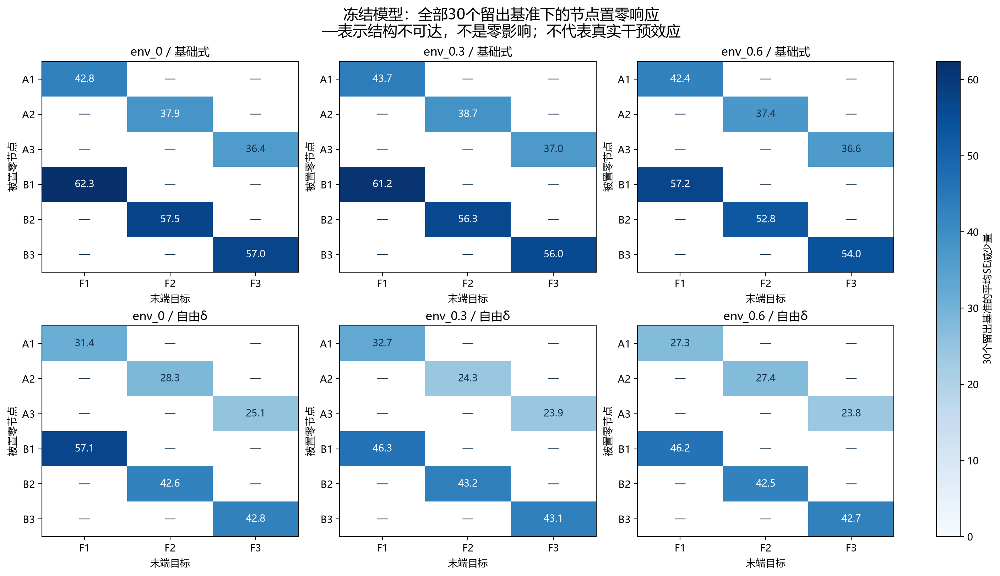
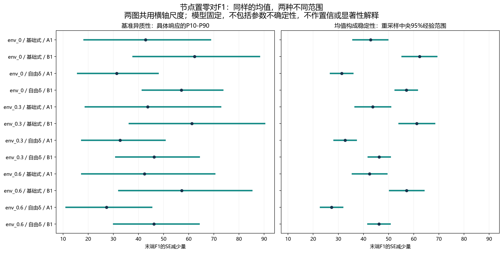
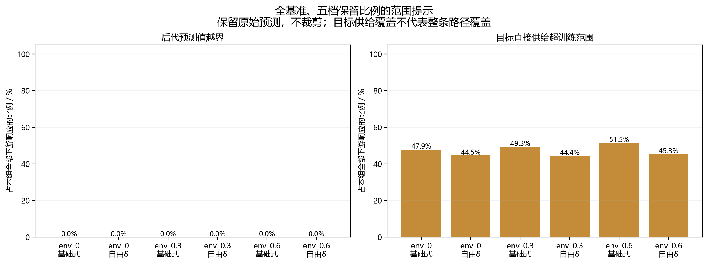

# 冻结模型的全留出基准传播补充分析

保留原FDNA参数和SE，把原首条留出基准扩展到每个任务全部30条留出记录。五档保留比例为0、0.25、0.5、0.75、1。干预值为节点的模型基准值乘保留比例；中间节点暂停入边，根输入和其他机制不变。节点自身不算其后代。

共180个“模型任务×基准”组合、8100条下游响应、270行条件化摘要。原首条基准270条响应均保留，最大数值差0。核心干预公式交叉核验8100次，最大差2.84217e-14；非后代不变检查通过。

## 图1：末端平均响应

每格是固定模型在30个不同留出基准下、某节点置零引起的末端平均SE减少量。横线表示结构上没有可达后代记录，不能读成观测到零影响；不同任务分量之间没有自动新增供给边。该图用于说明模型内传播，不能作真实节点因果重要度排名。

## 图2：两种范围分开看

左图为30条具体基准响应的P10-P90，描述基准异质性；右图是复用04包2000次成组索引后，平均减少量的2.5%-97.5%经验范围，描述均值对样本构成的波动。两图共用横轴尺度，两者统计对象不同，不应混称置信区间。图中展示节点置零对拓扑首个末端F1的影响，完整节点和五档比例均保留在CSV/JSON中。

## 图3：推演范围限制

全部响应中0条预测值越界，3819条目标直接供给超训练范围。输出没有裁剪；越界和外推保留为解释限制。外推标记只检查该目标的直接供给，不意味着传播链其他位置均在训练覆盖内。

## 边界

这补充了冻结模型的基准响应差异与均值构成稳定性，不包括训练重采样后重拟合、参数或求解器不确定性；不是参数置信区间、真实干预因果或新拓扑实验。没有改变原公式、参数、SE、边界和结构。原06包及此前汇报保留。
