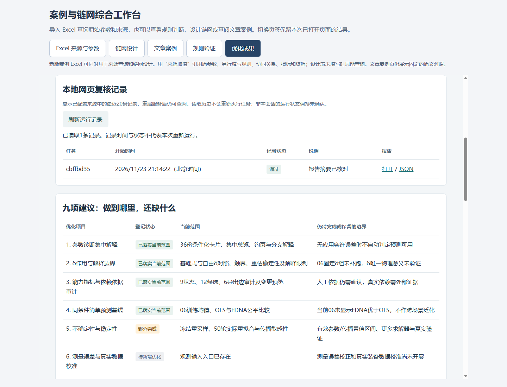

# 本地复核历史：核验快照

[使用说明](../recheck-history.md) · [只读审计](只读历史核验.json) · [浏览器检查](浏览器自动检查.json) · [上次完整数值报告](../web-recheck-report/本次完整复核.md)

服务重启后，“本地网页复核记录”可打开已保存的报告。每个任务有固定链接，启动新任务后旧报告地址仍有效；读取历史不重新运行数值任务，损坏记录和状态未确认记录单独标示。

真实旧任务cbffbd35a3b84ce597cd5aed65e01f10在新会话中成功读取，其历史报告为full、十项独立复核通过。6个运行文件读取前后的SHA-256全部相同，子进程启动0次，当前会话始终idle。上述十项通过属于历史执行，本轮没有重跑十项数值任务。

219项不同相关测试通过，包括新增10项历史、固定链接、损坏记录、HTTP和Windows短暂/持续文件占用测试。Edge无界面自动检查通过历史加载与刷新、JSON下载、当前会话空闲、原图文新标签页和390像素无整体横向溢出；截图已查看。不声称手动UI验收。

Windows状态读写使用同一锁，并对替换时短暂文件占用最多尝试三次，持续失败仍报告失败。本轮改善使用便利和可靠性，九项研究建议仍为5项已落实当前范围、2项部分完成、2项待新增优化；没有新增模型精度或真实有效性证据。

JSON保留本地实测记录，manifest.json登记此快照其他文件的精确字节摘要。固定报告URL仅在配置了对应本地来源的服务中有效，GitHub阅读历史报告可使用上方仓库内链接。
