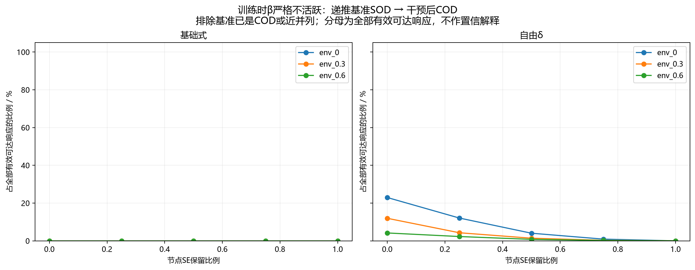
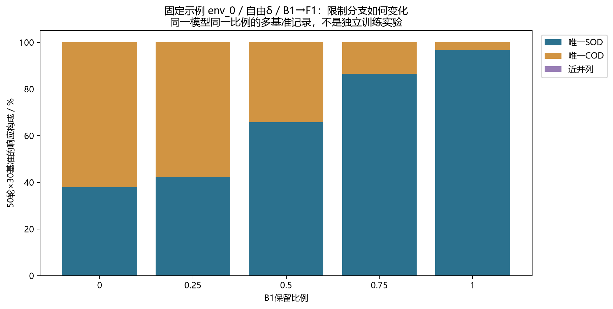

# 为什么普通预测不能代替退化传播诊断

本步扩展已有冻结模型分支解释，检查08的50轮重估实验模型在09全部405000条响应中的目标限制分支。没有新增拟合、改变参数、改边、重生成SE或覆盖历史输出。以1e-8为近并列容差，在加δ之前比较SOD与COD；近并列保留双候选，不选唯一导数。仅适用于当前已验证的单供给结构，多输入明确拒绝。

当前单供给公式为 `SE = min(100 − α(100 − x), x + β) + δ`。前一候选称SOD，后一候选称COD；两者取较小值。训练时x为登记的观测供给，传播时x为根观测或上游递推输出，内部节点不读取留出真值。

“训练时β严格不活跃”指该轮90条成组抽样训练记录中，目标方程全部由唯一SOD限制，没有COD或近并列。这里是局部公式上的零敏感度证据，不证明全局唯一、β值正确或没有其他识别途径。重复训练记录仍非新的独立基础样本。

1800个局部拟合中，1588个符合上述严格定义，其中146个在本批递推/干预情景的至少一条记录上由唯一COD限制。全部响应中9009条符合“训练β严格不活跃、该响应唯一COD”；其中9009条目标直接供给超当轮训练范围，0条未超该范围。它们不全由退化新触发：8789条从同模型递推基准的唯一SOD转为唯一COD，220条基准已是COD，0条基准为近并列。第一张图只统计前一类，保留比例1时应为0。分母和训练不活跃模型数逐条件保存在CSV中，不把这些记录当作独立训练实验或显著性检验。

继续使用09预先指定的env_0/自由δ/B1→F1示例，不按结果挑例。第二图包含全部50轮模型，不限于“训练β严格不活跃”的子集，不能把第二图全部COD比例当成第一图的启用率。第一图基础式的零值也不能推出基础式更可靠或更准确，只说明本批模型未出现所定义的切换。

唯一SOD下，固定输入及其他参数时，局部输出对β的导数为0；唯一COD下为1；近并列不指定唯一导数。δ在min之后相加，固定输入时不改变SOD/COD选择，但上游δ仍可改变递推供给。因此图中分支变化不能单独归因于某个参数，更不能把局部斜率乘以大退化量当作全程响应。

保留比例0时，各模型绝对强制值均为0；非零比例下，各模型自己的基准可能不同。训练分支使用观测供给，留出基准与干预分支使用递推供给，不能把两者差异只归因于退化。另行保存“同模型递推基准SOD→干预COD”计数，避免混淆。

本步具体说明了原先“训练时不活跃参数可能在强退化时启用”的机制与本批证据；没有提高FDNA预测精度，也没有给出置信区间、真实因果或更通用拓扑验证。原09输出逐条保持一致，公式重算最大差0。
