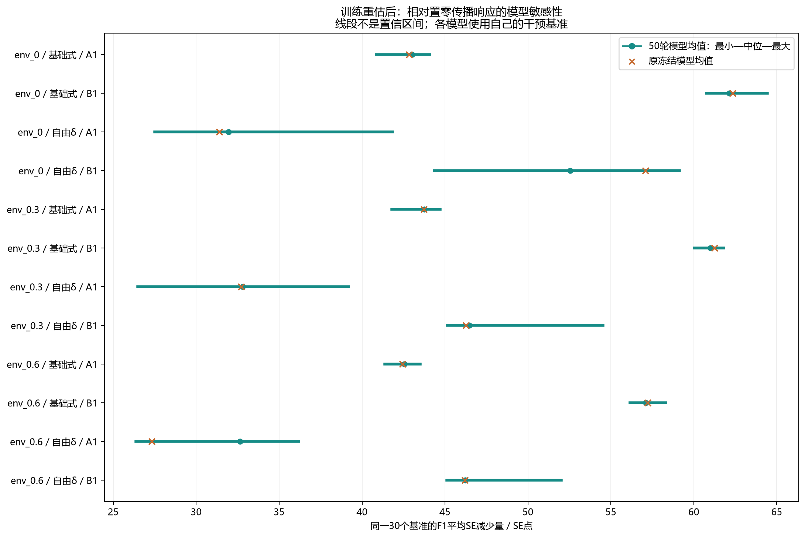
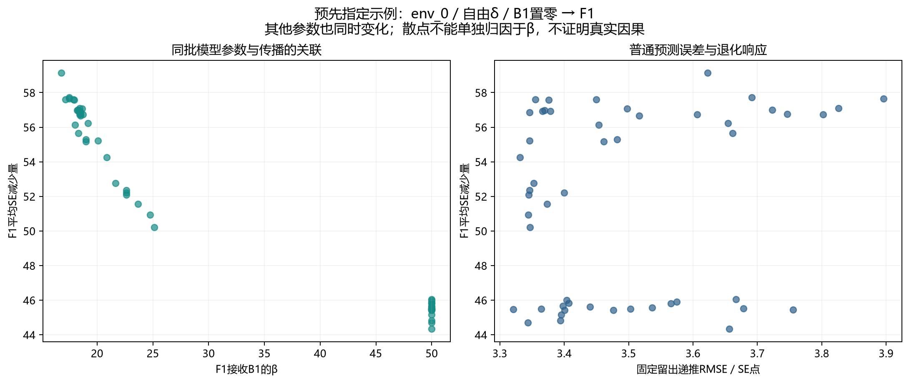

# 重估模型的相对退化传播敏感性

对08的50轮训练重估模型，保留同一30个留出根观测和五档保留比例，重算405000条可达下游响应；不重新拟合，不更换拓扑，也不覆盖原模型。先用完整训练控制模型回放07的8100条响应，最大数值差为4.26e-14。

每轮先对同一30个基准求平均，再报告50轮均值的最小、中位、最大；橙色叉为原模型均值。不同于07的冻结模型基准构成波动，本图包含训练构成变化后的重新估计。范围不是置信区间，不将50×30个组合视为1500个独立训练实验。

运行前固定示例为env_0/自由δ/B1置零→F1：原模型平均减少量为57.090，重估模型为44.345—59.132，中位数52.552 SE点。图中参数、误差与响应的关联不能单独归因于β；其他参数同时变化。训练区间内不活跃的参数，可能在强退化时参与计算，普通预测误差不能代替传播响应稳定性的检查。

本轮405000/405000条响应可用，目标输出越界0条，目标直接供给超当轮重采样训练范围199146条；保留原值，不裁剪。后者只描述目标直接供给覆盖，不代表整条路径。各模型干预值为自身基准×比例，绝对值可能不同，因此这里是相对退化情景的模型敏感性。

单个任务任何接受节点拟合失败则整任务不替补；基准缺失保留NaN和valid掩码，只有完整30基准面板才计算模型均值，分母固定50。本轮不能证明参数唯一、物理意义、真实因果或FDNA优于线性基线，也未覆盖其他结构、求解器或真实数据的不确定性。此前已查看的留出集不作为新的独立测试。
