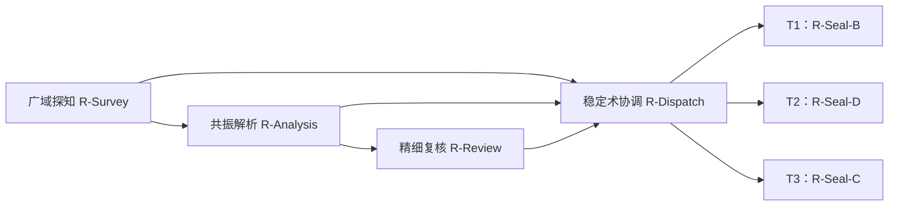

# 最终实验任务：从本体推理到三、四、五环节链网生成

本案例已在现有 `design` 引擎上运行。建议将它作为多环节扩展的最终综合任务：用同一个知识库和同一批法器，为三个不同复杂度的任务生成候选链，进行评价，再在共享资源约束下选出一个完整链网。

## 1. 背景和任务

迷雾之海出现三处不稳定的空间裂隙。同盟需要使用探知法器、协调法器和稳定法器，完成裂隙定位、必要的解析与复核、稳定术协调及最终封印。

| 任务 | 目标条件 | 到法器的设定距离 | 必须包含的环节 |
| --- | --- | ---: | --- |
| T1 | 普通裂隙：已知波形，无需额外解析 | 5 | 广域探知 → 稳定术协调 → 裂隙稳定 |
| T2 | 共振裂隙：需先解析共振，再进行稳定术协调 | 15 | 广域探知 → 共振解析 → 稳定术协调 → 裂隙稳定 |
| T3 | 迷雾裂隙：存在波形干扰，解析后还需专用法器精细复核 | 25 | 广域探知 → 共振解析 → 精细复核 → 稳定术协调 → 裂隙稳定 |

所有任务在相对时间0秒开始，每项任务的目标数量为1。距离、速度、高度均为虚构演示单位，不作地理坐标换算。裂隙静止，`target_speed=0`；高度与平台高度均设为50，共鸣阻抗阈值为2。这些数值用于填全规则输入。

T2的两个协调环节由不同法器承担，所需能力不同；T3的两次探知也由不同法器承担。因此增加环节有明确的功能含义。T3保留五个环节，不另外强加评估步骤。

## 2. 对代码的对应关系

当前存在两种扩展，使用时必须区分：

- `design/sequences.py`：读取配置模板的环节和顺序，逐环节推理筛选执行对象、检查相邻连接、形成候选链，再接回评价和组网。本次完整实验走此入口。
- `task_flow/planner.py`：从活动前置条件与效果搜索活动顺序，配有独立验证器；目前还没有接通法器资源适配和原链网组装。本次不将它当成已经接通的端到端流程。

本次三种活动顺序由 `knowledge/rift-multistep.flows.json` 明确提供；程序搜索的是满足这些顺序的法器分配方案，**不会自行发现或发明这三个活动顺序**。若研究目标改为“根据状态自动决定是否增加复核”，后续应研究 `task_flow` 与资源适配的衔接，不能仅靠改模板声称已经实现。

代码路径为：`design/knowledge.py` 加载知识 → `design/owl_scene.py` 构建场景并调用HermiT → `design/sequences.py` 分配环节执行对象 → `design/engine.py` 汇总和评分 → `design/search.py` 资源约束搜索 → `design/article_sequence.py` 核验多环节表10协同 → `design/rdf.py` 导出设计。

## 3. 知识设计

新增五个具名能力，URI统一使用 `urn:arcane-rift-demo:` 前缀：

| 能力 | 角色 | 活动名 | 执行法器 |
| --- | --- | --- | --- |
| WideSurvey：广域探知 | insight | observe | R-Survey |
| FineScan：精细复核 | insight | observe | R-Review |
| ResonanceAnalysis：共振解析 | coordination | decide | R-Analysis |
| Dispatch：稳定术协调 | coordination | decide | R-Dispatch |
| Stabilize：裂隙稳定 | manifestation | act | R-Seal-A/B/C/D |

OWL充分必要定义根据 `targetType` 推出目标分类，再沿 `hasTarget` 推出 `Mission1/2/3` 任务分类，利用 `requiresCapability hasValue` 推出整体任务所需能力。法器只填本体类别，通过类别限制推导角色及 `hasCapability` 具名关系。输入文件不手写这些整体任务能力结论。

环节能力由模板明确声明，并通过本体类别与HermiT结论核验；不将模板中显式写入的环节能力称为全新推导出的需求。整体任务推导出的能力须由模板环节能力覆盖。

每件法器还有本实验明确列全的 `supported_functions`。规则同时要求“在明确功能清单中”及“有对应OWL能力结论”，让不支持某一功能的同角色法器确定退出候选。单纯缺少OWL结论在开放世界下仍表示未知，不能据此认定不具备能力。

## 4. 规则与资源

保留截图表10的目标类型匹配、探知距离、具现作用范围、共鸣阈值、速度、高度、平台激发高度等检查，并启用 `article_table10=true`。各字段都显式给值；没有沿用截图中最小/最大距离颠倒的异常数据。

| 法器 | 作用/探知范围上界 | 耗时/秒 | 单次精度 | 单次成本 | 容量/库存 |
| --- | ---: | ---: | ---: | ---: | --- |
| R-Survey | 60 | 2 | 0.99 | 1 | 并发容量3 |
| R-Review | 40 | 3 | 0.98 | 2 | 并发容量3 |
| R-Analysis | — | 2 | 0.99 | 1 | 并发容量3 |
| R-Dispatch | — | 1 | 0.99 | 1 | 并发容量3 |
| R-Seal-A | 10 | 2 | 0.90 | 9 | 容量1、库存1 |
| R-Seal-B | 20 | 4 | 0.95 | 6 | 容量1、库存1 |
| R-Seal-C | 30 | 6 | 0.99 | 3 | 容量1、库存1 |
| R-Seal-D | 40 | 9 | 0.97 | 5 | 容量1、库存1 |

成本单位统一为 `demo-credit/use`。稳定法器最小距离为0，共鸣效值为10，可适应目标速度上界为10；目标高度与平台激发高度上下界均为0和100。所有阈值检查按代码保留严格大于/小于。

允许的有向连接为：Survey→Dispatch、Survey→Analysis、Analysis→Dispatch、Analysis→Review、Review→Dispatch，以及Dispatch→每件Seal。每条边传讯距离为1、上界为50；最后一类边同时有统筹关系。未要求的连接没有自动补齐，也不推断跨节点传递通信。

探知最大标记数为4；协调最大解析目标数为4。三个同时共享的目标数总和为3，满足截图的严格条件 `4 > 3`。这个标记数与工程并发容量3是两个不同约束。

多环节表10适配按实际活动 `[start,end)` 区间检查共享，每条链的目标数只计一次。具现法器在整个计划中只能属于一条链。工程资源约束另核验并发容量、库存和冷却。本实验冷却时间为0。

## 5. 评价方法

使用 `sequential_product`：逐环节耗时相加、精度相乘、按次成本相加。每个法器在 `activity_metrics` 中给出指标，旧 `metrics` 留为null，不以原文表13或共鸣效值替代使用成本。

时间和成本越小越好，精度越大越好。每个任务的候选链内部进行极差归一化，权重分别为0.3、0.3、0.4；所有值相等的指标赋0.5。网络目标为三个任务评分的平均值。

以上为可复现实验的工程设定，精度乘积并未由实测验证，网络分数也不是任务成功概率。不同任务的归一化分数不直接代表绝对性能可比。

## 6. 已运行结果

| 任务 | 候选链数量 | 选中链 | 环节数 | 耗时/秒 | 精度乘积 | 成本 | 链评分 |
| --- | ---: | --- | ---: | ---: | ---: | ---: | ---: |
| T1 | 4 | Survey → Dispatch → Seal-B | 3 | 7 | 0.931095 | 8 | 0.580952 |
| T2 | 3 | Survey → Analysis → Dispatch → Seal-D | 4 | 14 | 0.94119003 | 8 | 0.283333 |
| T3 | 2 | Survey → Analysis → Review → Dispatch → Seal-C | 5 | 14 | 0.9413840898 | 8 | 1.000000 |



图表示三条选中链的节点和边的并集；各任务依照表中的有序路径执行。共享节点是同一法器，并非另建副本。

候选组合为 `4×3×2=24`，独立枚举可行组合为8，唯一最优组合为 `(B,D,C)`，网络分数为 `87/140≈0.6214285714`，计划跨度14秒，总成本24。基准分支定界实际检查18个完整组合；这些搜索计数与全部24组组合数含义不同。

三个任务各自最喜欢Seal-C，但不能同时分给三个任务。整体最优把它留给T3，将Seal-B和Seal-D分给T1、T2，而不是直接组合三条局部最高分链。

## 7. 运行和验收

在项目根目录运行：

```powershell
# 完整基准：请使用尚不存在的输出目录
.\.venv\Scripts\python.exe -B -m design run design/examples/rift_multistep_demo.json --output-dir generated/rift_multistep_demo/my_run --require-canonical

# 推荐：一键执行完整流程、独立手算对照和反例；每次创建独立目录
.\.venv\Scripts\python.exe -B -m workflow_tools.verify_rift_multistep_demo
```

验证脚本使用实际CLI、实际HermiT推理和严格RDF导出。它不只检查程序有没有报错，还独立计算原始指标、手算评分、枚举法器组合，并检查：

| 验收条件 | 预期状态 |
| --- | --- |
| 基准配置 | complete；包含3/4/5环节的选中链 |
| 切换穷举搜索 | complete；24组中8组可行，与分支定界选择及评分一致 |
| R-Review不可用 | no_feasible_design；T3无五环节链 |
| Analysis→Review明确不通联 | no_feasible_design；不能跳过复核或偷偷绕路 |
| Survey最大标记数由4改为3 | no_feasible_design；3不严格大于3 |
| 缺少Review探知距离 | blocked；未知数据不能冒充满足 |
| Seal-C/D库存均为0 | no_feasible_design；T3没有可用的远程稳定法器 |

失败或阻塞情形不生成选中设计 `design.ttl`。这些反例验证约束与缺失事实确实影响结果。

主要文件：

- [场景输入](../design/examples/rift_multistep_demo.json)：任务、资源、指标、连接与政策。
- [本体扩展](../knowledge/rift-multistep.ttl)：新能力、目标类别、任务类别和法器类别。
- [业务规则](../knowledge/rift-multistep.rules.json)：法器环节资格筛选。
- [三种顺序模板](../knowledge/rift-multistep.flows.json)：明确的3/4/5环节。
- [验证入口](../workflow_tools/verify_rift_multistep_demo.py)：独立预期与七组运行。
- [输入重建脚本](../workflow_tools/prepare_rift_multistep_demo.py)：恢复实验初始输入；会覆盖上面四个实验输入文件，修改实验数据后请勿随意重建。

每次输出的 `design_report.json` 给出OWL结果、逐环节候选筛选、连接依据、资源占用及组网结果；`design_summary.md` 为摘要；`reasoning_input.ttl` 可在Protégé中查看完整输入，`reasoning_result.ttl` 保存回流具名结论，`design.ttl` 保存选中网络。验证总目录的 `verification.json` 汇总七组结果。

本实验可以验收“给定多环节模板下，本体推理—候选筛选—连接检查—逐环节评价—资源约束组网—RDF导出”已经接通。它不验收自动活动顺序发现、自动调度、动态仿真或论文原始数值复现。
