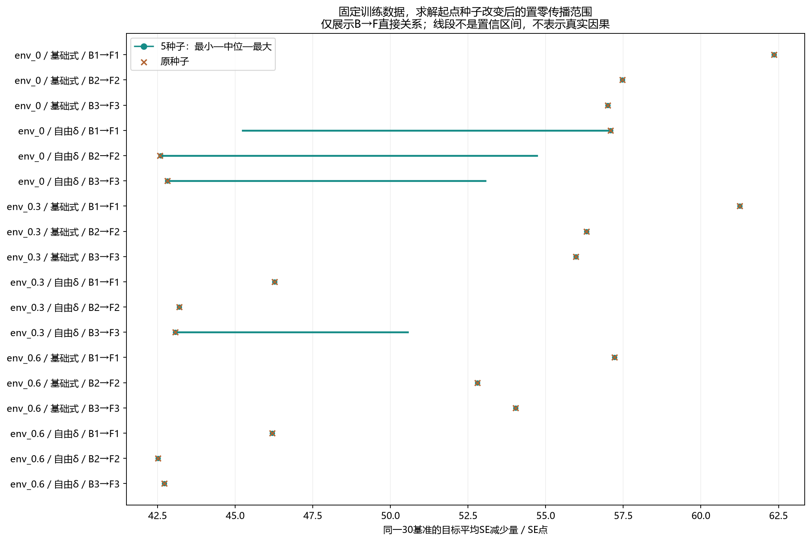
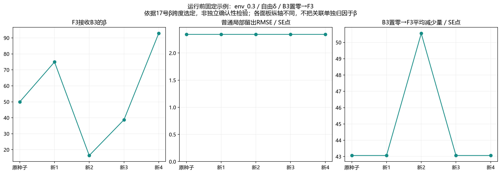

# 求解起点种子模型的退化传播：结果与汇报说明

## 这一轮回答什么问题

17号实验已发现同一数据下β可能随起点种子明显变化、普通预测却很接近。本轮继续追问：把这些已经估计好的模型用于退化传播，结论是否仍接近？它对应优化清单第5项，补的是初值敏感性向传播结果的传导，不是新增真实数据实验。

上一轮代码2d7e4bd已联网确认与GitHub一致，17号结果的独立标量复核再次通过。本轮复用五个原登记种子模型，不重新拟合、不生成SE、不改拓扑、不挑选种子、不替换原正式模型。

## 预先登记的面板与控制

同一30个原留出基础样本，3种环境×2种模型、9组可达关系、保留比例0/0.25/0.5/0.75/1，共5×6×9×5×30＝40500条响应。这里只读取原A1/A2/A3根观测，内部节点来自各模型递推预测；干预节点强制为本模型自身基准×比例，暂停其入边，再计算后代。

先用原种子复现07的8100条冻结传播响应，最大差约4.26e-14。模型中任一接受节点失败，该任务保留不可用，不用原参数补齐；只有完整30基准才计算模型均值，计划分母始终为5。本批40500条均可用，输出越界0条，目标直接供给超原训练范围19080条，占47.11%。外推仅检查目标直接供给，不代表整条路径都在训练范围内；保留原数值，不裁剪。

## 图1：求解起点变化确实会传到传播结论

图中只展示18组B→F直接关系的置零响应，完整9组可达关系和全部比例保存在数据文件中。每个种子先对同一30基准求平均，再展示五个均值的最小、中位、最大；橙色叉为原种子。点线重叠表示这一有限种子面板内数值接近，不表示参数真实或全局唯一。

270个条件包含54个保留比例为1的恒等控制条件。其余216个非恒等条件中，81个条件的模型均值跨度超过1e-8。跨度最大的条件是env_0/自由δ/B2置零→F2，平均减少量范围42.572315—54.721779，跨度12.149463 SE点。这是运行后的描述性极值，条件重复使用同一数据，不作为216个独立实验或显著性检验。1e-8只是数值近等阈值，不是应用容许误差。

## 图2：普通预测相同，置零传播仍可不同

本轮运行前固定两个示例：env_0/自由δ/B1置零→F1沿用09；env_0.3/自由δ/B3置零→F3依据17号已观察到的β跨度选定。本图展示后者，它是对已知现象的机制追查，不是新的独立确认性测试。各面板纵轴不同，不能按折线视觉斜率比较量级。

| 种子 | β | 普通局部留出RMSE | B3置零后F3平均减少量 | 置零后唯一COD限制条数 |
| --- | ---: | ---: | ---: | ---: |
| 原20261122 | 50.000000 | 2.344347 | 43.065610 | 0/30 |
| 新1：2026112401 | 74.930884 | 2.344347 | 43.065610 | 0/30 |
| 新2：2026112402 | 16.381619 | 2.344347 | 50.551225 | 30/30 |
| 新3：2026112403 | 38.748723 | 2.344347 | 43.065610 | 0/30 |
| 新4：2026112404 | 92.814301 | 2.344347 | 43.065610 | 0/30 |

五次的训练局部敏感度诊断均标记β不活跃。B3置零后，目标F3的COD=β，SOD约为23.867235；新2的β=16.381619小于SOD，因而转为COD限制，其余种子由SOD限制。局部留出RMSE相同，没有约束住训练范围外置零情景中的全部响应。

这个示例的目标供给置零超出了训练范围，属于模型外推，不能当成真实故障实验。并且种子同时改变多个方程的参数，递推基准也可能变化；图中是同批模型的关联与分支检查，不是隔离β的因果效应。原种子的43.065610也不能因已有历史记录就被视作真实值。

另一个预先固定示例env_0/自由δ/B1置零→F1的平均减少量范围45.239757—57.090183 SE点；完整逐种子指标见[固定示例表](固定示例.csv)。

## 核验、文件与复跑

独立标量公式核验全部40500条响应、256500次数值非后代不变性比较、原种子8100条控制响应、270行条件摘要、1350行种子均值和10行固定示例；最大绝对差约4.26e-14。没有调用生产传播函数或重新拟合。

233项不同相关测试通过，包括新增7项：预测相同而置零传播不同、不读取内部真值输入、失败分母保留、控制响应篡改/重复、分支统计、无参数失败记录展示和非空输出保护。最终代码在临时新目录回放后，全部数组、数值报告及CSV与首次结果一致，不将复跑重复计为新实验。

- [汇总报告](seed_propagation_report.json)、[预登记方案](预登记方案.json)。
- [传播范围摘要](传播范围摘要.csv)、[逐种子平均响应](逐种子平均响应.csv)、[固定示例](固定示例.csv)。
- [完整数组与掩码](逐种子逐基准数组.npz)：轴标签见汇总报告axes，保留baseline、forced、changed、decrease、valid、outside、extrapolated。
- [独立标量核验](独立标量核验.json)、[回归测试记录](回归测试记录.json)、[最终代码回放一致性](最终代码回放一致性.json)、[执行环境与代码版本](执行环境与代码版本.json)。

[源码运行与复核说明](../seed-propagation.md)。本快照manifest.json核对其他全部文件精确字节，包含已有核验记录；独立复核需指向本地完整来源。原06、07和17来源包保持原样。

## 可以怎样向老师解释

“此前检查了起点种子对参数和普通预测的影响，这次进一步检查它是否改变退化传播。在固定数据和五个种子的有限实验中，部分模型即使普通预测相同，置零传播仍存在差异；分支记录显示，训练中未被有效约束的参数可能在外推退化情景中参与限制。因此普通预测、参数解释与传播可靠性需要分别验证。”

这轮提高的是传播解释和复核证据，没有证明真实因果、全局最优或FDNA优于OLS。比例非零时各模型采用自身基准，绝对干预值可能不同；比例0强制值相同，但其模型基准及其他参数仍可能不同。范围不是置信区间，未覆盖其他求解器/PCA/更多起点、训练重采样×种子交叉设计或真实数据校准，第5项整体仍部分完成，九项分类不变。

公开快照CSV只规范行尾为LF，保留BOM和全部数值，原本地文件与其摘要不变。原七包统一目录仍为原登记，本新增成果使用独立核验入口。
