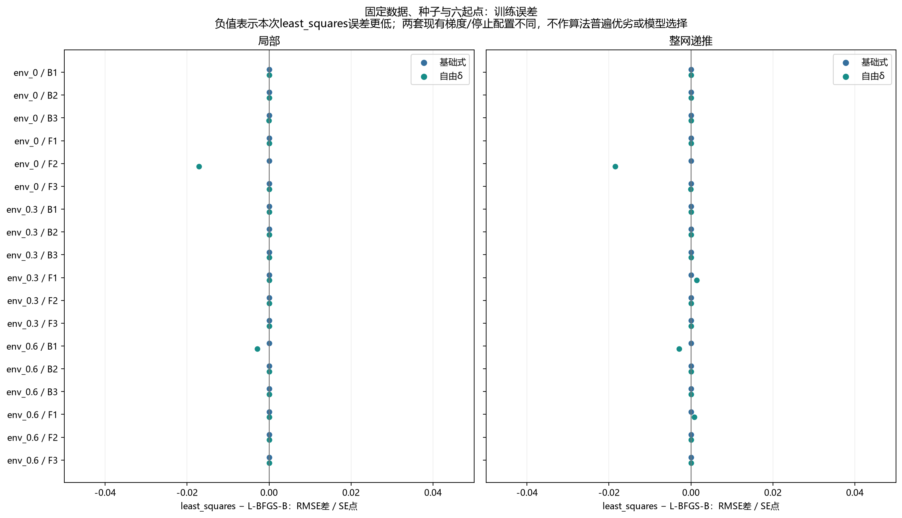
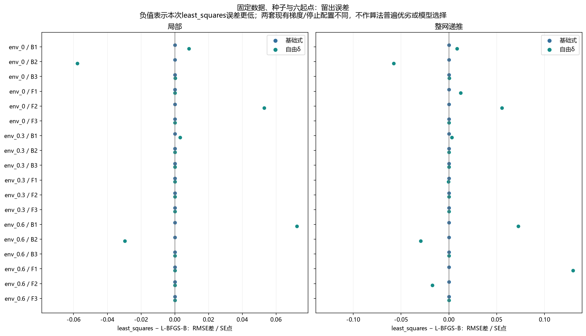

# 固定起点下 L-BFGS-B 与 least_squares：结果与汇报说明

## 本轮比较范围

本步对应优化清单第5项的求解配置敏感性。计算前固定06原始90训练、30留出基础样本、三种环境、基础式/自由δ、同一随机种子20261122、六个初值、参数界限及数值上限1500，只把现有`solver`设置从L-BFGS-B换为least_squares。每一算法都独立使用相同初始向量，不跨算法热启动，均只根据自己的训练损失和现有收敛并列规则选本算法内部解；不跨算法选优，也不按留出选择。

这不是完全隔离“算法名称”的实验。L-BFGS-B在当前实现中用解析梯度和minimize收敛条件；least_squares使用残差、有限差分雅可比和自身停止准则。相同1500数值限制不等于相同函数调用、梯度计算量或时间预算。因此本轮比较的是两套现有求解流程，不能据此宣布某算法总体更好或更快。

## 控制、拟合与诊断

两套流程各完成36次局部拟合，共72次；每个局部拟合6个起点，共432个起点尝试，全部拟合与432次尝试均返回成功。原L-BFGS-B控制复现正式06中的90个参数值和8640个预测，最大差0；06的94个源文件校验通过。

| 诊断 | L-BFGS-B | least_squares |
| --- | ---: | ---: |
| 局部秩不足 | 34/36 | 31/36 |
| 不活跃参数标记 | 34/36 | 31/36 |
| 多初值参数跨度 | 36/36 | 36/36 |
| 自由δ触界 | 12/18 | 10/18 |
| 参数值差超过1e-8 | 43/90 | 43/90 |

两列诊断来自不同最终点和本模型已有敏感度计算；仍然大量秩不足、参数不活跃或多初值跨度，说明“拟合成功”没有消除参数解释限制。参数跨算法有差不自动意味着预测应明显不同，也不能把状态标记当成置信概率。

## 图1：训练误差变化

纵轴按环境/节点分组，蓝色基础式、绿色自由δ。横轴为least_squares减L-BFGS-B，负值表示本次least_squares训练误差较低；它不是跨数据或跨问题的算法排名。

基础式18个局部训练RMSE条件全部在1e-8数值阈值内近等。自由δ18条件中5个超过该阈值；自由δ的平均局部训练RMSE为L-BFGS-B 2.758582、least_squares 2.757474 SE点。最大单条件训练差为env_0/自由δ/F2，least_squares低0.017151 SE点。训练误差较低不保证留出或参数解释更优。

## 图2：留出误差变化

留出数据已在此前分析中查看，本图不是新独立泛化测试。局部留出仅用相同供给观测预测目标；递推留出只使用原外部根观测，不额外喂中间节点真值。

基础式局部与递推18条件均在1e-8内近等。自由δ局部18条件有9个超过阈值，递推18条件有12个超过阈值；least_squares相对L-BFGS-B的平均自由δ留出RMSE：局部2.771912对2.769133，递推3.104428对3.094619 SE点。均值差很小且各条件方向不一；最大单条件递推差出现在env_0.6/自由δ/F1，least_squares高0.129770 SE点。不得从有限已查看条件中选择更有利算法。

| 模型/层次 | 条件数 | 误差差超过1e-8 | L-BFGS-B平均RMSE | least_squares平均RMSE |
| --- | ---: | ---: | ---: | ---: |
| base / train / local | 18 | 0 | 4.671529 | 4.671529 |
| base / train / recursive | 18 | 0 | 6.134352 | 6.134352 |
| base / holdout / local | 18 | 0 | 4.555725 | 4.555725 |
| base / holdout / recursive | 18 | 0 | 5.966979 | 5.966979 |
| free_delta / train / local | 18 | 5 | 2.758582 | 2.757474 |
| free_delta / train / recursive | 18 | 8 | 2.954925 | 2.953861 |
| free_delta / holdout / local | 18 | 9 | 2.769133 | 2.771912 |
| free_delta / holdout / recursive | 18 | 12 | 3.094619 | 3.104428 |

## 独立核验与复跑

标量脚本检查72个局部拟合、432个起点向量及训练损失、180个选中参数值、2160个局部与2160个递推留出预测、288项分层指标、22374个CSV字段，以及06原L-BFGS-B控制。最大绝对数值差约2.84e-14。来源94文件前后摘要一致。完整拟合记录、配对差CSV、图表、核验与执行环境记录都保存在本目录。

246项不同相关测试通过，其中新增6项本步单测。首次计算已成功写入结果目录；同目录复跑按保护规则拒绝覆盖。磁盘空间恢复后只重新生成图像、更新图像摘要并复核，拟合记录和数值结果均未重跑。

复跑须指定新的空目录，以保留首次结果；命令和范围说明见[源码说明](../solver-comparison.md)。本地清单校验12项求解输出的精确字节；独立复核还检查全部CSV字段、每个起点训练损失和原控制。原正式参数、SE及留出划分均未更改。

## 可用于汇报的表述

“固定06合成数据、样本划分和同一组六起点后，对比现有L-BFGS-B解析梯度流程与least_squares有限差分流程。基础式误差近乎一致；自由δ下，least_squares在本次部分训练条件误差较低，但留出条件有升有降。两者都暴露参数诊断限制，因此目前不据此推荐一个普遍更优求解器。”

本轮未计时、未比较同等函数评估预算、未覆盖其他起点数/PCA、未复算退化传播；不构成算法排名、预测改进或有效参数区间。参数差超过1e-8的43/90项只作为数值敏感性记录。九项优化分类不变，第5项仍部分完成。

快照manifest.json核对其余文件精确字节；CSV只规范化CRLF为LF，BOM及单元格内容保持不变。本快照用于阅读，完整标量复核仍需本地06来源包。
