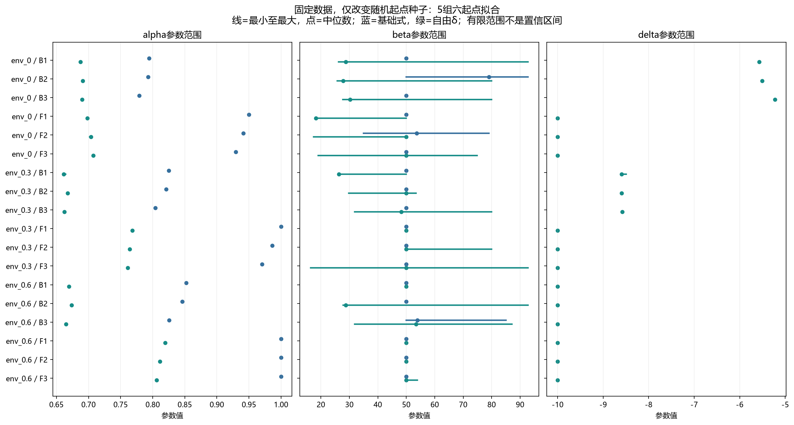
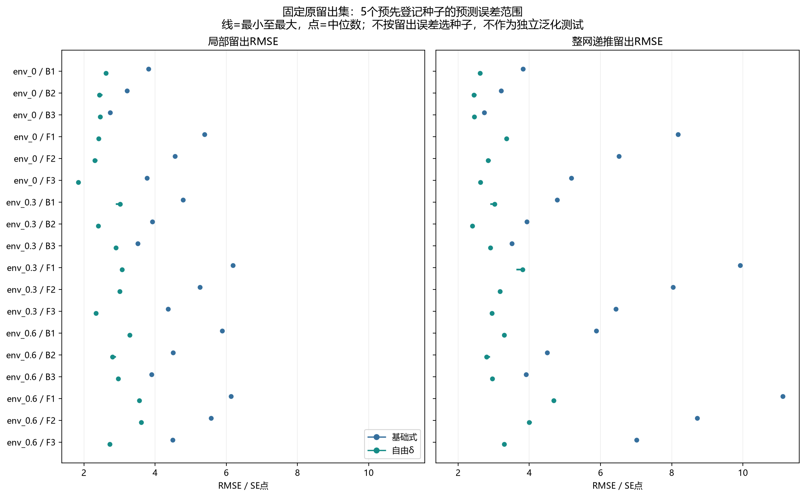

# 固定数据，仅改变求解起点种子：结果与汇报说明

本步对应优化清单第5项，以及论文分析中的初值敏感问题。此前08的50轮实验改变训练构成但固定求解种子；本步反过来固定数据与划分，检查更换随机起点集合是否改变估计和普通预测。

## 做了什么

计算前固定五个种子：20261122、2026112401、2026112402、2026112403、2026112404。保留原90个训练基础样本、30个留出基础样本和三种环境；每组仍为一个中性起点、五个随机起点，L-BFGS-B、1500上限、相同参数边界。不重采样训练、不生成新SE、不改拓扑、不热启动，不使用留出误差选择种子或模型。所有种子均保留并报告。

共180次局部拟合，其中36次为原种子控制，144次为新种子拟合。它们重复使用同一数据，不是180个独立实验。控制复跑90个参数、8640个预测值与原结果最大差0；原06的94个文件前后校验一致。

## 图1：参数变化不等于预测变化

蓝色为基础式，绿色为自由δ；线为最小到最大、点为中位数，没有变化的范围显示为点。每一行固定环境和接受节点。以1e-8为数值比较阈值，36个α条件中5个变化、36个β条件中17个变化、18个δ条件中4个变化。这是有限种子范围，不是置信区间，也不是参数物理可靠性的评分。

180次拟合全部成功，但169次标记局部秩不足、180次有多初值参数跨度；自由δ的90次拟合中60次触界。标记可以重叠。成功返回没有消除约束不足，参数也没有因补跑种子就变得可辨识。

一个事后描述性示例是env_0.3/自由δ/F3：五个种子的β从16.381619到92.814301，跨度76.432682；选中训练RMSE跨度约4.44e-16，局部留出RMSE均为2.344347。该条件五次均有局部秩不足与不活跃参数标记。它说明当前观测范围可能允许不同β给出相同普通预测，不能只挑一组β作确定解释；也不能据此推断退化传播必然相同。本示例按运行后观察到的最大β跨度说明现象，不是预先指定验证目标。

## 图2：固定留出集的普通预测敏感性

左右分别为局部和整网递推留出RMSE，共用横轴，图例标示模型；局部预测提供目标直接供给观测，整网只提供原外部根输入。没有因为更换种子增加中间节点真值输入。

| 比较项 | 36个环境×模型×节点条件中跨度超过1e-8的数量 | 最大跨度 |
| --- | ---: | ---: |
| 局部训练RMSE | 5 | 0.017178 SE点 |
| 递推训练RMSE | 7 | 0.018473 SE点 |
| 局部留出RMSE | 7 | 0.107080 SE点 |
| 递推留出RMSE | 9 | 0.145762 SE点 |

递推留出RMSE最大跨度出现在env_0.3/自由δ/F1，范围为3.662803至3.808565。汇总误差的跨度不能替代逐条预测检查：本批最大逐样本预测跨度为2.187885 SE点，出现在env_0.3/自由δ/B1的b070_e1局部预测。它们都是运行后的描述性极值，不作显著性、因果或应用合格判断。1e-8仅区分数值近等，不是应用容许误差。

## 独立核验与文件

独立标量脚本核对1080个起点训练损失、450个选中参数值、10800个留出预测值、720个训练/留出RMSE、9720个摘要值和26820个CSV字段，最大绝对差约2.84e-14。还按种子重建全部随机起点集合，确认中性起点保留、仅种子变化、原训练/留出面板和参数边界未变。226项不同相关测试在完整复跑中通过；首次回归中原Excel HTTP测试出现一次WinError 10053连接中止，单独重跑及完整复跑均通过，异常说明保留在测试记录中。见[独立标量核验](独立标量核验.json)、[回归测试记录](回归测试记录.json)。

- [原始汇总JSON](seed_report.json)：来源摘要、控制对照、诊断和全部范围。
- [预登记方案](预登记方案.json)：固定种子、设置及不选择模型的政策。
- [参数范围](参数范围.csv)、[训练损失与诊断](训练损失与诊断.csv)、[训练与留出误差](训练与留出误差.csv)、[逐留出预测范围](逐留出预测范围.csv)。
- 本地generated/关于优化/17_求解起点种子敏感性/逐种子记录/保留五个完整紧凑记录，包含所选参数、全部起点、训练/留出指标和逐条留出预测。
- [执行环境与代码版本](执行环境与代码版本.json)：软件版本和相关代码内容指纹。

运行与独立核验命令见[源码使用说明](../solver-seed-sensitivity.md)。本公开快照的manifest.json核对其他文件的精确字节，包含历史核验记录。独立核验必须指向本地完整结果目录；本快照未重复上传“逐种子记录/”五份完整记录。

## 能用于汇报的表述

“在固定06合成数据、训练留出划分和求解设置下，补充五个预先登记起点种子的敏感性实验。180次局部拟合均成功，但仍有大量参数约束不足。部分条件的β变化较大而普通预测几乎不变，另一些条件的留出预测确有变化，因此预测误差和参数解释需要分开评估。”

本轮补的是初值种子敏感性证据，没有替换原正式参数，没有按留出结果挑更好的种子，没有证明全局最优或预测优于OLS。五组共享中性起点，是固定六起点机制下的有限诊断；未更换求解器、未比较PCA或更多起点、未计算新种子模型的完整退化传播，不是置信区间或真实数据验证。第5项仍为部分完成；九项分类仍为5项已落实当前范围、2项部分完成、2项待新增优化。

发布CSV仅将行尾规范为LF，保留BOM与全部数值；本地原始CSV及其清单保持原字节。
