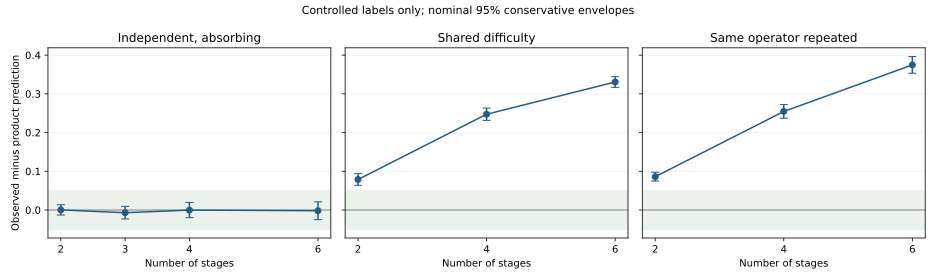

# 阶段三：串行多环节正确率的受控检验

**真实领域有效性：pending。数据为合成标签与明示故障注入，不是真实法器试验。**

19场景×5种子，95份原始压缩CSV，共1,425,000个样本观测。每场景每环节校准25000个样本，端到端评估50000个独立留出样本。
判定规则在运行前冻结：5个百分点容差、按场景名义95% Wilson/Bonferroni包络及每分层类别至少100个样本。没有根据结果重新挑选种子或阈值。

受控结论计数：blocked_population_mismatch=1, equivalent_within_tolerance=8, systematic_overprediction=1, systematic_underprediction=9。

## 分场景结果

正偏差表示乘积低估，负偏差表示乘积高估。区间是实测率与预测乘积差异的保守名义95%包络；人群不匹配一行只作描述，不作为有效模型检验。

| 场景 | 长度 | 乘积预测 | 实测终点正确率 | 偏差及区间 | 判定 |
| --- | --- | --- | --- | --- | --- |
| A-observe-1 | 1 | 0.8986 | 0.9001 | +0.0015 [-0.0057,+0.0088] | 当前容差内等效 |
| A-decide-1 | 1 | 0.8510 | 0.8501 | -0.0009 [-0.0095,+0.0077] | 当前容差内等效 |
| A-act-1 | 1 | 0.9497 | 0.9497 | +0.0000 [-0.0052,+0.0054] | 当前容差内等效 |
| B-independent-2 | 2 | 0.7658 | 0.7660 | +0.0002 [-0.0129,+0.0136] | 当前容差内等效 |
| C-independent-3 | 3 | 0.7307 | 0.7236 | -0.0070 [-0.0231,+0.0094] | 当前容差内等效 |
| C-independent-4 | 4 | 0.6169 | 0.6167 | -0.0002 [-0.0198,+0.0196] | 当前容差内等效 |
| C-independent-6 | 6 | 0.4459 | 0.4440 | -0.0019 [-0.0248,+0.0212] | 当前容差内等效 |
| D-shared-difficulty-2 | 2 | 0.4950 | 0.5738 | +0.0788 [+0.0638,+0.0939] | 系统性低估 |
| D-shared-difficulty-4 | 4 | 0.2336 | 0.4809 | +0.2474 [+0.2315,+0.2631] | 系统性低估 |
| D-shared-difficulty-6 | 6 | 0.1169 | 0.4477 | +0.3308 [+0.3168,+0.3444] | 系统性低估 |
| D-independent-matched-4 | 4 | 0.2404 | 0.2380 | -0.0025 [-0.0177,+0.0126] | 当前容差内等效 |
| D-exclusive-errors-2 | 2 | 0.4236 | 0.3025 | -0.1211 [-0.1354,-0.1068] | 系统性高估 |
| E-repeated-2 | 2 | 0.8125 | 0.8986 | +0.0860 [+0.0748,+0.0975] | 系统性低估 |
| E-repeated-4 | 4 | 0.6472 | 0.9017 | +0.2546 [+0.2370,+0.2724] | 系统性低估 |
| E-repeated-6 | 6 | 0.5243 | 0.8991 | +0.3748 [+0.3533,+0.3966] | 系统性低估 |
| F-repair-2 | 2 | 0.7999 | 0.9593 | +0.1595 [+0.1513,+0.1678] | 系统性低估 |
| F-flip-2 | 2 | 0.4837 | 0.5803 | +0.0966 [+0.0816,+0.1115] | 系统性低估 |
| F-flip-4 | 4 | 0.2414 | 0.5119 | +0.2706 [+0.2545,+0.2865] | 系统性低估 |
| M-population-shift-4 | 4 | 0.7286 | 0.1189 | -0.6097 [-0.6267,-0.5920] | 人群不匹配，阻塞 |

## 可作出的结论

独立且失败吸收的控制组支持乘积在本轮给定人群、正确率及容差内的适用性；它们本身按已知机制构造，只是正控制，不是现实领域验证。
共享难度与重复算子产生相关错误，固定边际率相乘低估；互斥错误使乘积高估。独立翻转仍可能因错误抵消而恢复正确，表明“误差独立”也不能单独保证最终正确率等于乘积。
可信参考核对器在正确输入上正确率为1，但对错误输入有修复作用；忽略这一状态转换会漏算恢复路径。
链式法则的条件率乘积可以复算“全过程每个中间输出正确”的频率，但不是“最终输出正确”的独立预测，且不应复用评估集拟合条件率后再宣称验证通过。
不能把本轮模型反例解释为原论文必然错误。若原文精度指连续误差或其他指标，二元正确率的受控结论不能直接搬用。软件公式及版本保持原样，真实领域有效性继续pending。

## 证据与复现

[冻结协议](protocol.json)、[全部分组/种子统计](results.json)、[95份CSV清单](raw-inventory.json)、[独立标签重放](independent-label-audit.json)、[测试日志](tests.log)及[摘要清单](manifest.json)。
raw目录保存全部压缩CSV，每行包含真实标签、故障日志、影子探针输出与实际串行输出；没有只保留平均误差。每环节样本量、置信区间、配对错误列联表、零方差说明、恢复次数、条件样本覆盖均在results.json。
置信包络按各场景分别解释，不作跨19场景同时95%覆盖声明；Wilson近似区间不是必然包含理论概率的保证。解析理论值用于说明已声明机制，没有用它生成最终成功标签。
