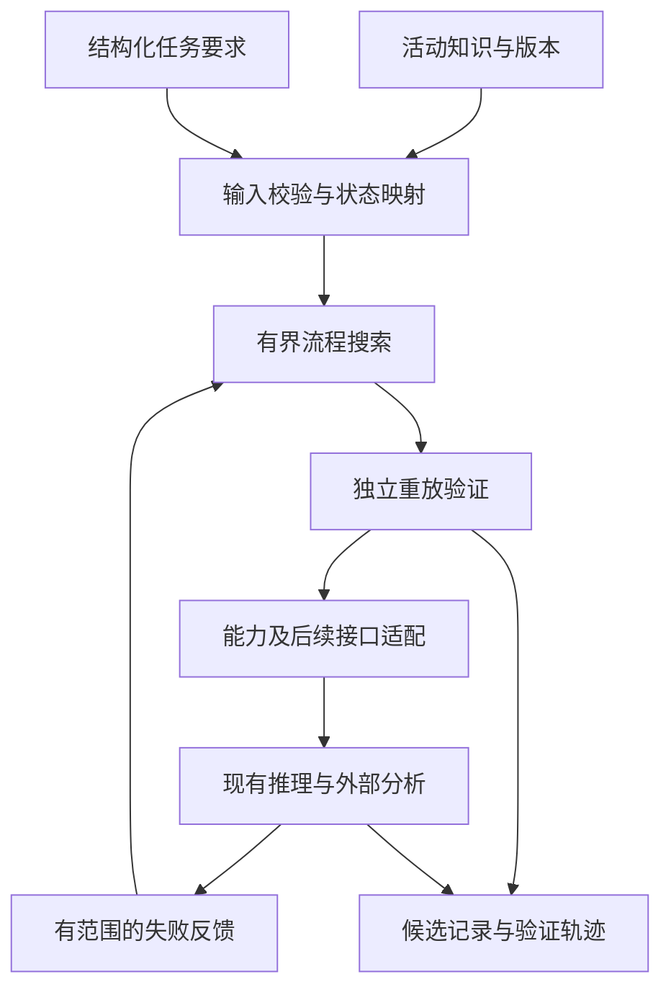

# 总体设计与接口草案

协议标记：`task-flow-draft-0.1`。本文件是第一阶段设计决策，不是可调用API或已完成的Schema。

## 模块边界

拟新增独立包 `task_flow/`；第二阶段起逐步建立，第一阶段不创建空实现。

建议职责：`contracts`校验与版本；`state`生成侧条件/状态；`grounding`有限实例化；`planner`搜索与恢复；`validator`独立条件/效果重放；`adapters`能力需求与兼容性检查；`feedback`作用范围管理。共享数据定义与纯解析是允许的，验证器不得直接调用生成侧的条件判断或状态转换实现，也不信任生成器给出的后状态。独立实现仍可能共同误解规则，须另做穷举及人为错误流程实验。

## 输入与输出字段草案

| 数据对象 | 必需信息 |
| --- | --- |
| 活动目录 | `format_version`、`catalog_id`、`version`、对象域、事实声明、派生规则、活动定义、来源 |
| 活动定义 | `id`、类型、有限参数域、`preconditions`、`effects`、适用条件、能力需求、使用约束、版本/来源 |
| 任务要求 | `request_id`、目录版本与摘要、初始状态、静态事实、最终目标、必需活动、禁止条件、重复限制、搜索边界与模式 |
| 活动实例 | `activity_id`、活动版本、完整参数绑定、序列位置；不以装备ID代替活动身份 |
| 候选流程 | 请求/目录/输入摘要、候选ID、有序活动实例、能力需求及来源、生成阶段检查记录 |
| 搜索报告 | 搜索状态、终止原因、边界、是否穷尽、已产出候选ID、统计、未知条件阻塞、可恢复标识 |
| 验证报告 | 候选及输入摘要、版本、通过/拒绝/未知阻塞/未运行、逐步条件及状态差异、终点与必需活动检查 |
| 外部反馈 | 候选ID、上下文摘要、外部分析器版本、结果、失败环节、原因、证据、适用范围 |

ID由协议版本、规范化后的输入和完整参数序列计算稳定摘要；规范化算法与Unicode/数值处理在第二阶段固定，不能只依赖显示标签或列表顺序。来源文件摘要用于锁定原始输入，语义摘要用于绑定运行对象，两者区分。

## 状态语义

首版布尔事实用“谓词＋有限对象参数”标识，取 `true/false/unknown`；JSON缺省事实视为未知，不是false。显式false表达已知否定，unknown与false不能混淆。正负冲突、未声明谓词、重复事实键、非法参数、NaN/Infinity、类型或单位错误属于输入无效。示例暂用无参数谓词，完整参数化身份在第二阶段落定。

- 静态事实只读，活动不能修改。
- 可变事实由活动效果写入；遗忘/删除事实将其置为unknown，显式否定须写false。
- 派生事实禁止活动直接写入。每次转换后依据当前基本事实重算，首版采用有限、无循环的派生规则子集，拒绝递归否定及自引用。初版可全量重算，优化另验收。
- `all`仅当所有子条件为true才为true；存在false则false，否则unknown。`not`只在已知真/假之间反转，unknown保持unknown。不提供“未证实即否定”的隐含运算。
- 前置条件和适用条件都必须明确为true才可执行；false为不满足，unknown记录阻塞。未知可被后续合法活动效果消除，因此不能因一条分支出现unknown就提前停止整个搜索。
- 效果从执行前基本状态统一读取，先计算后原子提交；同一事实被重复或冲突写入、非法数值更新整步拒绝，不依赖效果列表顺序。效果不直接写派生事实。
- 初始状态和每步后状态都检查禁止条件：true则违规，unknown则当前候选尚未得到安全性证实，不能报告验证通过；其他分支仍可搜索。
- OWL保留开放世界语义。只把明确映射、带证据和版本的结论导入，未推导不等于false。首版静态本体与可变规划事实分离；不在一个不断累积的OWL场景中保留过期派生结论。

数值比较、精度、单位、溢出与除零政策属于第二阶段必须冻结的契约事项。布尔最小模型验收不等于已支持任意数值表达式。

## 有限性、搜索与终点

活动参数来自有限对象域，实例数为G，长度上限为L；未经剪枝的候选序列数上界为 `sum(G**k for k in range(L+1))`。有限不等于小，必须另设节点数/时间预算。节点计数、超限检查时机、稳定实例顺序在第二阶段规定；首版不声称分数最优或最短。

两种模式为 `first_feasible` 和 `enumerate_bounded`。首解模式可暂停；独立验证或外部分析拒绝当前候选后，从保留的前沿继续，排除键绑定候选和外部上下文摘要。进程内恢复为首版目标，跨进程检查点恢复后置。

终点同时满足最终目标、全部必需活动及全程约束。长度0也参与检查。枚举模式在找到合法终点后仍继续合法后继，直到长度L或穷尽，从而保留更长但合法的不同序列；最终目标被破坏的后继不算终点。重复次数与必需活动历史进入搜索状态。不得仅按最终事实去重，不得用全局“访问过状态”直接丢弃另一条前缀；未来任何等价剪枝须证明保留要求的序列集合。

## 结果状态分离

搜索、每个候选的逻辑验证和外部分析是三个字段，不合并为单一success。

| 字段 | 草案枚举与含义 |
| --- | --- |
| `search_status` | `invalid_input` 输入不合法；`input_incomplete` 结构必需知识缺失；`candidate_found` 首解暂停；`exhausted` 边界内遍历完成；`limit_reached` 未完成 |
| `verification_status` | `not_run`、`passed`、`rejected`、`blocked_unknown` |
| `external_status` | `not_run`、`passed`、`rejected`、`unsupported_mapping`、`blocked_unknown` |
| `coverage` | `not_started`、`partial`、`complete`；仅表示声明语义与边界下的序列搜索覆盖 |

未知状态可以是合法输入，不一律记为input_incomplete。已穷尽但仍有可能影响结论的未知阻塞时，应报告“保守语义下没有得到可证实方案，存在未知阻塞”，不能断言实际任务不可行。没有阻塞且完整遍历才可报告声明边界内无解；不能推广到更长流程或其他知识版本。

超限时保留先前已独立验证的候选，报告coverage=partial。找到候选不意味着外部可实现，逻辑验证失败也不意味着搜索无解。统计至少包括扩展节点、尝试转换、候选数、拒绝数、未知阻塞、运行时间和终止原因。

## 旧系统接口及资源共享边界

通用活动保留自己的ID与语义，通过具名能力URI、来源和映射版本输出需求。现有任务能力推理仍可在资源落实阶段补充需求；不把规划器的效果当成真实观测或实际装备可用性。

旧 `design/schema.json`、`validate_sequences`、RDF导出及FDNA桥接有不同适用限制，适配器逐项检查。能适配到旧顺序模板的流程才传递给现有序列生成；空流程、少于三步、未知活动、缺少合法角色/能力映射返回unsupported_mapping。不能填充假步骤、替换活动含义、塞入同值性能指标或伪造selected报告使接口通过。

FDNA桥接目前仅支持single_unit_per_role；即使旧设计器能接受某个ordered_steps流程，也不能据此认为FDNA桥接可用。逻辑动作的前后依赖不自动等于FDNA效能依赖边，仍需产品定义、来源与审查。

多流程共享一个资源继续由现有占用检查承担；新的规划逻辑不代替库存、容量和时序校验。跨任务共享状态、同环节多装备分担及动态竞争是不同机制。本阶段不扩展这些算法。

外部分析拒绝只在绑定的目录/请求/资源上下文内排除确切候选。没有可靠证据的反馈不推广到活动、前缀或所有参数；上下文变化后旧拒绝不能直接复用。
