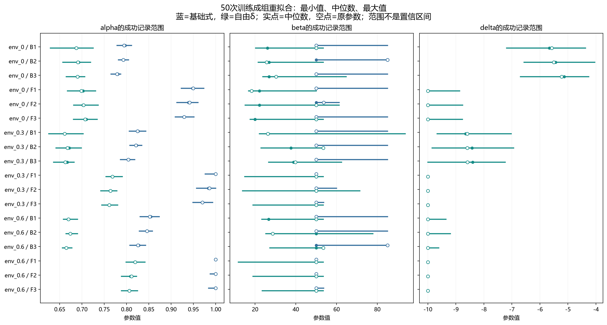
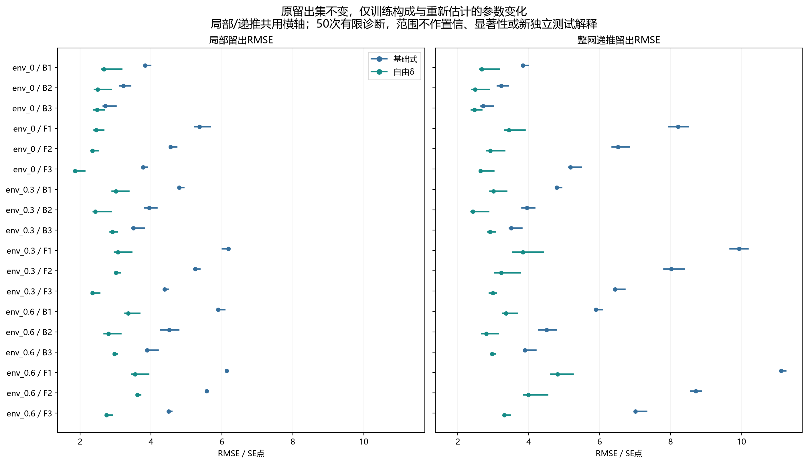

# 训练构成改变后实际重拟合：有限敏感性诊断

保留原30个留出基础样本，对90个训练基础样本成组抽样90次，重复50轮，联合保留全部环境与节点。原求解器、6起点、种子及边界不变，不热启动。原模型和SE来源包不覆盖。

完整训练控制复跑通过，90个参数值、8640个预测值最大差0。50轮共1800次局部拟合，0次未成功；每轮实际不同训练基础样本数为49至65，不能把重复90条当成90个独立样本。

## 参数变化

线表示成功拟合的最小到最大，实点为中位数，空点为原参数。范围只描述这50次有限抽样和固定求解设置；波动小不证明参数唯一或真实，尤其要结合局部秩、不活跃参数、触界与多初值跨度。失败分母保留在诊断频次表。

## 留出预测变化

留出记录保持原样，只改变训练构成并重新估计。局部与递推分别报告，不读取中间目标真值做递推。已有留出此前已查看，本步不选择方法，不作为新独立测试或方法普遍优势证据。

本步确实重新估计了实验模型，区别于04和07的参数冻结重采样；但仍不提供参数置信区间，也没有重新估计模型的全传播不确定性或真实因果验证。原正式结果保留。

## 主要诊断发现

1800次拟合均成功返回，但1588次局部秩不足、1745次存在多初值参数跨度；900次自由δ拟合中545次触界。标记可重叠，不能相加。成功或波动较小不能单独证明参数唯一。

例如env_0/B1基础式，50次α范围约[0.778669,0.811188]，β范围[50,85.0598]且中位数50。β较大跨度与原不活跃参数诊断相呼应；不能将中位数50当成真实依赖值。

env_0.6/F1在自由δ模型中，固定留出局部RMSE范围约[3.46013,3.93596]，递推范围约[4.62450,5.25309]。这只说明当前抽样与固定求解设置下重新估计的变化，不用于选方法或调边界。

本步124项相关测试通过。独立核验10800个起点训练损失、4500个选中参数值、108000个留出预测值和486个摘要值，最大差约2.84e-14。原正式参数保持原样；本目录保存的是新重新估计的实验参数。局部/递推图共用横轴，颜色和模型图例已标明。

## 误差不变也需要解释

env_0.6/F1基础式在50轮中均取α=1、β=50，单输入预测等于供给值，因此在固定留出上的局部RMSE恒为6.13256。不能据此自动认定模型稳健、参数唯一或物理正确。原报告记录的正结构误差下界为5.26941，与实际RMSE不同，不声称已达到全局最优。

单输入基础式在x∈[0,100]、α∈[0,1]、β≥0下满足预测≥x；当观测目标小于供给时存在表达约束。负δ可以改变这一约束，但当前改善不证明δ具有唯一物理成因，也不直接代表真实机制。
