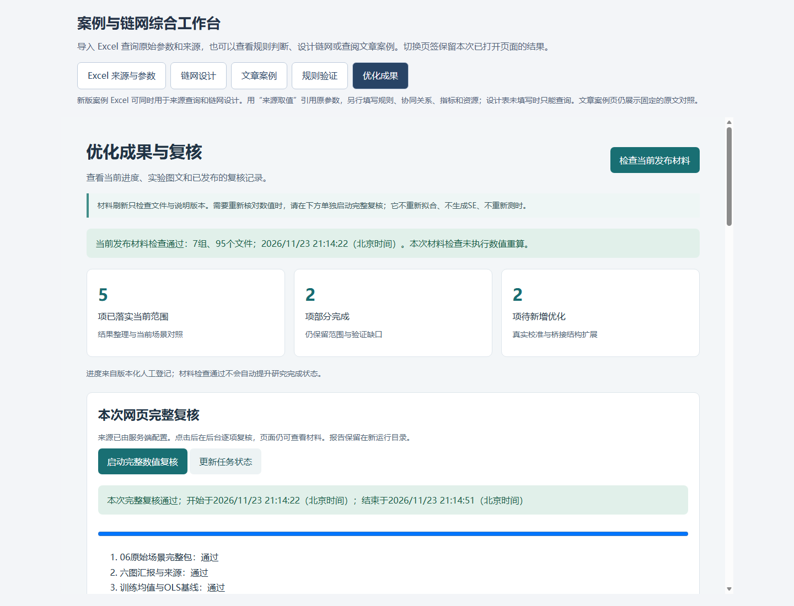

# 网页后台完整复核：本次执行快照

[使用说明](../web-recheck.md) · [本次完整报告](本次完整复核.md) · [本次JSON](本次完整复核.json) · [任务状态](任务状态.json) · [真实进度事件](任务进度.jsonl)

显式配置本地来源后，网页可启动后台完整数值复核、查看进度，并打开或下载本次报告。普通材料刷新、当前网页任务与已发布历史记录分别显示；不把材料检查当成数值重算。

本次由Edge无界面自动检查实际点击启动，十项独立脚本全部完成并通过；报告为full、95个发布文件、10项脚本已调用、数值任务完成、0项失败。209项不同相关测试通过，包括重复启动、状态响应、失败报告、报告变更、服务中断、初始记录保存失败与连续运行保留旧报告。不是手动UI验收。

任务在独立子进程运行，不阻塞网页，不使用浏览器输入的路径或命令；记录保存在新的任务目录，既有源包和已发布历史报告不覆盖。JSON保留原执行记录，Markdown链接已按GitHub目录重设；manifest.json核对此快照精确字节。

没有重新拟合、生成SE、改边或重新测时，不增加原九项研究建议的完成数量。数值复核通过仍不等于真实有效性验证。
