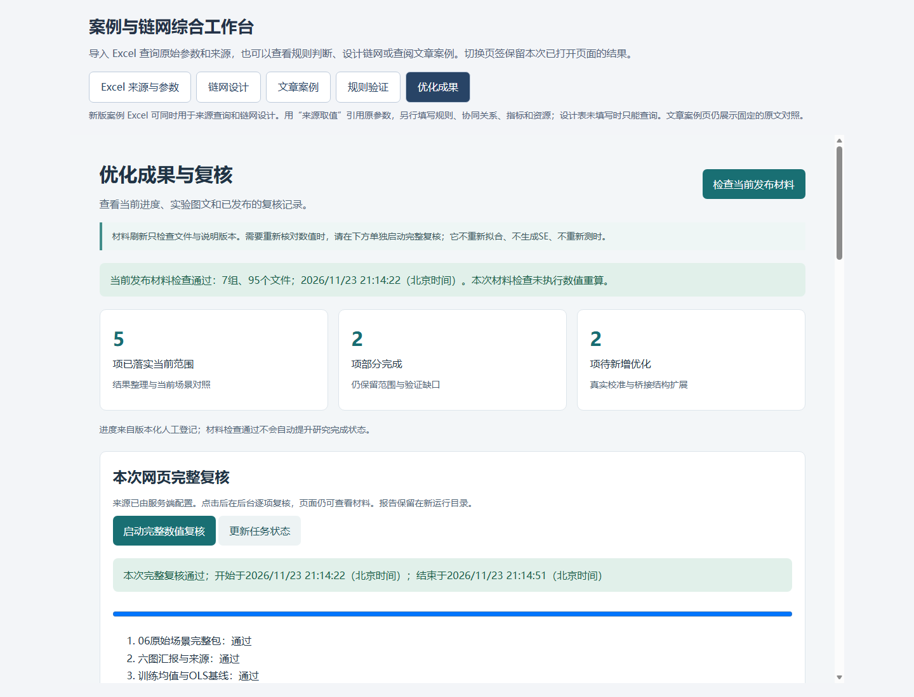

# 在网页后台执行本次完整复核

“优化成果”页签新增“本次网页完整复核”：点击启动后，后台独立进程逐项核对既有数值结果，页面显示十项任务进度、开始/结束时间，并能打开本次图文报告、下载本次JSON。材料刷新、当前网页任务和已发布历史记录分别显示。

## 启用与使用

默认只提供材料检查与原图文阅读。完整复核的本地来源必须在启动服务时显式配置，网页不接收目录、命令或上传文件。当前工作树示例：

```powershell
# 从.publish/fdna-bridge运行。--review-project-root指向包含原generated来源的项目根目录。
& '..\..\.venv\Scripts\python.exe' -B -m excel_entry.app --port 8765 --review-project-root '..\..'
```

打开综合工作台，选择“优化成果”，点击“启动完整数值复核”。任务进行时仍可查看页面、刷新材料或查询状态；刷新页面会接回本次会话的任务，不会自动启动另一份。重复启动请求返回同一进行中任务。结束后可以再次主动启动，新任务使用新目录，旧报告保留。

运行记录保存在配置项目根目录下`generated/关于优化/15_网页完整复核/运行记录/<任务编号>/`，包含`job_status.json`、`worker.log`与`report/`。报告内的模式为full，明确区分脚本是否实际调用和数值任务是否完成。

## 执行范围与失败处理

后台调用与CLI相同的十项独立复核，包括源包、来源CSV、标量数值和计时算术。它不重新拟合、生成SE、修改正式图、放宽参数边界或重新测时。完整复核需要原有FDNA依赖及本地来源；只读页面仍不加载拟合库。

任务在独立子进程中运行，标准输出写入该任务日志，不重定向网页进程的全局输出。启动记录无法保存时不留下虚假的运行中任务；子进程异常、摘要不符或不完整报告均不能标为通过。数值检查失败但形成完整诊断报告时，仍可打开/下载失败报告；报告下载时再次校验该次输出摘要。

启动接口沿用同来源检查，不接收浏览器指定路径或参数；报告接口只访问已配置运行目录内、任务编号对应且摘要一致的固定产物。关闭服务会终止未完成的子进程，并保留中断状态。重启后网页是新服务会话，“本地网页复核记录”仍可查阅最近20条旧记录；不会自动续跑，也不将它们当作本次任务或已发布历史记录。

每个任务的报告使用固定编号链接，新任务启动后旧链接仍指向原报告。非本会话中遗留的running状态显示为“运行状态未确认”，即使存在有效报告也不擅自认定任务完成。损坏的状态或报告单独显示错误，不隐藏其他正常记录。详见[历史记录与固定报告链接](recheck-history.md)。

## 本次验证

已联网确认上一轮f5e9a48推送一致，并重跑36项直接相关测试。新增功能后，209项不同相关测试通过，涵盖重复启动、状态响应、失败报告、关闭中断、启动记录写入失败、连续两次运行保留旧产物、报告变更和浏览器路径/跨来源请求。

本机Edge无界面检查实际点击启动，十项独立脚本全部完成并通过；本次JSON下载结果为full、95个发布文件、10项脚本已调用、数值任务完成、0项失败。材料刷新与历史记录仍独立显示。截图已查看，浏览器记录与完整报告见[本次网页复核快照](web-recheck-report/README.md)。本次是自动浏览器检查，不声称手动UI验收。



自动检查复跑（先启动上述配置来源的服务，示例可将端口改为8897）：

```powershell
node workflow_tools/check_evidence_browser.mjs --browser 'C:\Program Files (x86)\Microsoft\Edge\Application\msedge.exe' --profile '..\..\tmp\new-web-recheck-profile' --output-dir '..\..\generated\关于优化\15_网页完整复核\新的浏览器核验' --url 'http://127.0.0.1:8897' --run-recheck true
```

浏览器配置与输出须是不同的新空目录。此功能提高本地复核使用便利性，不提高FDNA预测精度，也不改变九项研究建议的完成分类。有限范围、既有留出及真实有效性等边界继续适用。
