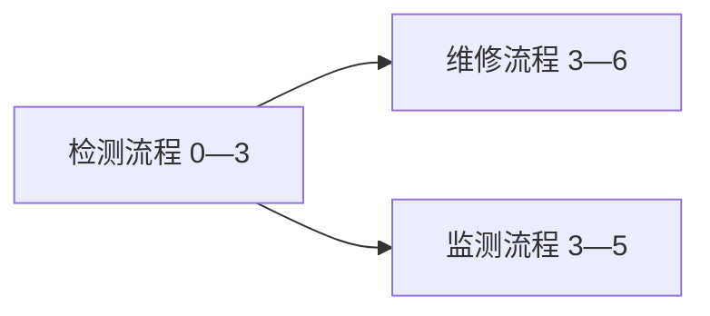

# 第二部分 2.1.2 与 2.1.3：维修流程协同验证

2026-10-24。本阶段复用 2.1.1 的两级映射，在独立维修示例中验证资源交接、有序流程和流程协作网络。程序不加载 `killweb_ontology.ttl`，也不实现其中的领域设计规则。主本体的规则说明与本目录的可执行维修政策应分别理解。

## 主要任务文件

- `maintenance_demo/collaboration/run_collaboration.py`：完整运行入口，调用原两级映射，检查协同条件、选择首个可行资源组合并导出流程网络。
- `maintenance_demo/collaboration/handoff_rules.rq`：报告交接的可执行规则。
- `maintenance_demo/collaboration/schema.ttl`：流程请求、参与记录、组合关系、容量和耗材词汇。
- `maintenance_demo/collaboration/input.ttl`：维修流程、时间窗口、资源事实和交接授权。

原 `mapping/task_rules.rq`、`mapping/resource_rules.rq` 继续负责 2.1.1，不改动其条件和边界。

## 2.1.2 的验证内容

先由任务条件推导能力、找到候选资源，再对候选组合执行维修交接规则：

1. 不同资源之间必须有方向明确的 `handoffAuthorized`。
2. 前一资源的 `outputFormat` 与后一资源的 `inputFormat` 至少有一个完全相同的格式字符串。
3. 双方均有显式可用标记。

满足条件时，SPARQL 生成 `canHandoffTo`。格式匹配不自动推导反向授权；它也不代表传输时延、物理距离或信息安全性质已建模。同一资源继续服务不发生跨资源交接，因而不另要求自交接授权。

每个请求的任务通过 `dependsOn` 构成一条单根、连通、无环的序列。任务顺序由输入的依赖决定，不能把不连通的任务简单排序后声称形成了流程。任务前置关系只允许位于同一请求内，跨流程依赖使用 `afterWorkflow`。

资源被选定后，程序为每次任务参与建立独立的 `Execution`，记录任务、资源、顺序、开始和结束时间，并以 `nextExecution` 连接。同一资源在两个流程中出现时是两个参与记录，避免顺序混淆。

## 2.1.3 的验证内容

| 内容 | 当前维修政策 |
| --- | --- |
| 串联 | 显式 `afterWorkflow` 建立前后流程关系；后续流程必须在前置流程全部任务结束后开始，且前置末任务到后续首任务的资源交接可行 |
| 并行 | 两条流程的起止时间包络存在严格正长度的重叠时，记录 ParallelRelation；接触端点不算重叠 |
| 分支 | 同一请求有两个及以上直接后继时记录 BranchRelation；本例为两个后继都执行的分支，不表示条件互斥选择 |
| 共享资源 | 按每个任务实际时间区间检查，同一资源同时服务数不得超过 capacity |
| 一次性维修耗材 | 每条 `usesSupply` 关系领用一份；本网络所有任务的合计需求不得超过 stockCount，时间先后不会恢复库存 |

时间区间采用 `[start, end)`，某任务恰好结束时可以释放容量供下一任务使用。流程包络重叠不等于其每项任务都同时执行；容量判定使用具体任务区间。

耗材是本维修示例的独立 Supply 实体，例如一次性检测试纸；可复用检测仪属于 Resource。输出只记录计划领用 `reservedSupply`，不修改真实库存，也不模拟实际消耗。每条关系一份的政策不支持在同一任务同一耗材关系上重复计数；更多数量需要另建领用明细。

## 示例结果

| 流程 | 任务与资源 | 时间窗口（分钟） |
| --- | --- | --- |
| 检测流程 | 检测留档→带记录检测仪；确认→基础检测仪 | 0—2、2—3 |
| 维修流程 | 维修作业→维修服务组 | 3—6 |
| 监测流程 | 监测留档→带记录检测仪 | 3—5 |



结果包含 3 个流程、4 个参与记录、2 个串联关系、1 个并行关系及 1 个分支关系。带记录检测仪先服务检测流程，之后服务监测流程，没有时间冲突；一份检测试纸仅被检测任务计划领用。

## 运行和输出

在仓库根目录执行：

```powershell
.\.venv\Scripts\python.exe -m maintenance_demo.collaboration.run_collaboration
.\.venv\Scripts\python.exe -m unittest discover -s tests
```

可选参数为 `--input`、`--output-dir`、`--max-combinations`。输入加载协同模式和原映射模式，不能输入旧的能力推理、候选关系、可交接关系或已生成流程。每个任务须且只能属于一个流程请求。

默认写入 `maintenance_demo/collaboration/generated/`：

- `validated_workflows.ttl`：已验证的流程、独立参与记录和组合关系。
- `merged.ttl`：模式、事实、两级映射、交接推理和流程结果。
- `collaboration_report.json`：匹配统计、资源组合数、实际评估数、拒绝原因、计划资源与耗材及关系说明。

程序按 IRI 稳定排序资源组合，找到第一个可行组合即停止，不作最优性声明。组合总数超过默认 10000 时报告搜索限制，不把它误报为已证明不可行。若可枚举组合全部被拒绝，则仅在当前候选、依赖和固定窗口政策下判定不可行。

退出码 0：找到可行组合；1：输入合法但当前请求不可行，仍输出诊断且不生成参与分配；2：输入/配置/文件错误或超出搜索上限。失败后应查看本次退出码，不能把之前输出当成本次成功结果。

## 验证结果

新增 26 项测试通过；连同现有实例校验和两级映射，共 52 项测试通过。覆盖：授权缺失、反向授权、格式冲突、不可用、任务与流程时间冲突、容量不足、容量增加、端点复用、耗材不足和充足、任务/流程依赖环、序列不连通、跨请求重复任务、未知任务、搜索限制及旧结果污染。

合并 RDF 静态检查通过：370 个三元组，0 错误、0 警告。该检查不替代完整 OWL 一致性推理。

## 第二部分阶段验收

| 小节 | 本项目当前交付 | 边界 |
| --- | --- | --- |
| 2.1.1 | 维修任务条件→能力→候选资源，含多能力全覆盖 | 维修政策；未接入主本体的领域规则 |
| 2.1.2 | 授权/格式/可用性交接推理，验证有序维修流程并选择资源 | 任务和依赖来自输入；不是自动发现任务分解 |
| 2.1.3 | 检查跨流程依赖、时间、容量和耗材，输出组合关系 | 固定窗口可行性；不是最优排程或条件分支规划 |

据此，第二部分的三个步骤已有可运行、可解释、可验证的非武器示例。不能称为截图全部领域条件的完整复现。评估部分式（4）—（10）仍仅有公式文本记录，本入口不计算它们。
